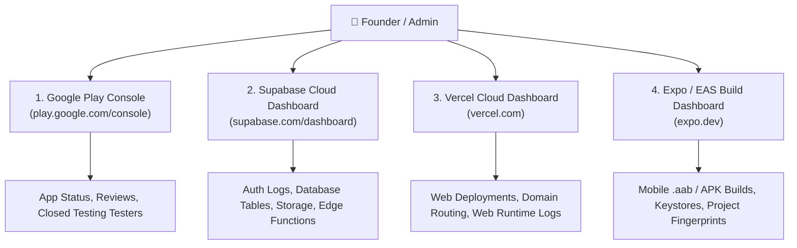

# LUVMEE — Administration & Operations Guide

**Document Version:** 1.0  
**Target Audience:** Founder, System Administrators, DevOps, and Support Leads  
**Last Updated:** October 16, 2026  

---

## 1. Executive Operations Overview

Operating LUVMEE does **not** require managing complex servers, configuring physical hardware, or writing daily code. 

The entire platform is built on modern, serverless cloud infrastructure:
- **Web App:** Hosted on **Vercel** (Automated scaling, SSL certificates, global CDN).
- **Backend & Database:** Hosted on **Supabase** (Managed PostgreSQL, automated daily backups, auto-scaling Auth).
- **Mobile Builds:** Hosted on **Expo Application Services (EAS)** (Cloud build workers).
- **App Store Distribution:** Managed via **Google Play Console**.

This guide explains the routine operational tasks needed to keep LUVMEE healthy, how to monitor system status, and how to resolve common operational issues safely.

---

## 2. Operations Dashboard Directory

As founder, you have access to four primary administrative dashboards:

---

## 3. Routine Operational Procedures

---

### Procedure 1: Checking Website Availability & Health
- **Purpose:** Ensure `https://luvmee.eventsslot.com` and its legal/sharing routes are live.
- **When Needed:** Weekly, or after any GitHub push to `main`.
- **Where to Check:** Any web browser or Vercel dashboard.
- **Step-by-Step Check:**
  1. Open an incognito browser window.
  2. Navigate to:
     - Homepage: `https://luvmee.eventsslot.com`
     - Privacy Policy: `https://luvmee.eventsslot.com/privacy`
     - Support Center: `https://luvmee.eventsslot.com/support`
  3. Verify that pages load quickly with HTTP 200 and proper visual styling.
- **Expected Result:** Clean page render in under 1 second.
- **Safe Recovery:** If a page shows a 404 error, log into Vercel ➔ Project: `luvmee` ➔ Deployments ➔ Click the latest deployment ➔ Inspect build logs.

---

### Procedure 2: Monitoring Authentication Health (OTP Deliverability)
- **Purpose:** Verify that users are successfully receiving 6-digit email codes.
- **When Needed:** If a user reports *"I didn't receive my login code"*.
- **Where to Check:** **Supabase Dashboard** ➔ Project: `zfcqbydqdmoyjgiebplo` ➔ **Authentication** ➔ **Logs** (or **Users**).
- **Step-by-Step Check:**
  1. Open Supabase Dashboard.
  2. Click **Authentication** in the left menu.
  3. Under **Users**, check if the user's email address is listed.
  4. Click **Logs** to check if the OTP email was dispatched or if rate limits were triggered.
- **Common Issues & Resolutions:**
  - *User mistyped email:* Verify the spelling of the email address.
  - *Spam folder:* Advise user to search their spam or promotions tab for *"LUVMEE"*.
  - *Rate limit:* Supabase enforces a 60-second cooldown between requests. Advise user to wait 60 seconds before tapping resend.

---

### Procedure 3: Monitoring Reminder & Push Notification Dispatch
- **Purpose:** Confirm that the daily 08:00 UTC reminder cron job and push edge functions are running.
- **When Needed:** Monthly audit, or if a user reports missing an anniversary reminder.
- **Where to Check:** **Supabase Dashboard** ➔ **Edge Functions** ➔ `dispatch-push-notifications`.
- **Step-by-Step Check:**
  1. Open Supabase Dashboard.
  2. Click **Edge Functions** in the left sidebar.
  3. Click `dispatch-push-notifications`.
  4. View the **Invocations** chart and **Logs**.
- **Expected Result:** Daily invocation spikes at 08:00 UTC with `200 OK` responses.
- **Safe Recovery:** If logs show `400 Invalid Push Token`, the user has uninstalled the app or revoked push permissions. The system automatically marks expired tokens inactive.

---

### Procedure 4: Reviewing Account Deletion Requests
- **Purpose:** Verify that account deletion requests are processing completely.
- **When Needed:** When a user submits a deletion request via the web form or mobile app.
- **Where to Check:** **Supabase Dashboard** ➔ **Edge Functions** ➔ `delete-user-account` ➔ **Logs**.
- **Step-by-Step Check:**
  1. In Supabase Dashboard, open `delete-user-account` logs.
  2. Search for the user's UUID or timestamp.
  3. Verify log output: `Deleted love notes`, `Deleted memories`, `Deleted profile`, `User purged from auth.users (200 OK)`.
- **Expected Result:** Complete scrub across all database tables.

---

### Procedure 5: Tracking Google Play Closed Testing Progress
- **Purpose:** Monitor tester opt-ins and count down the mandatory 14-day testing period.
- **When Needed:** Daily during the 14-day closed testing phase.
- **Where to Check:** **Google Play Console** ➔ App: `LUVMEE: Couples & Love Notes` ➔ **Dashboard**.
- **Step-by-Step Check:**
  1. Open Google Play Console.
  2. On the main Dashboard, look at the **"Production"** card.
  3. Check the counter: `X testers currently opted-in`.
- **Rule of Thumb:**
  - Google requires **at least 12 testers** opted in continuously for **14 consecutive days**.
  - Keep at least 15 to 20 testers enrolled to prevent dropping below the threshold if someone uninstalls.
  - On Day 15, the **"Apply for production"** button unlocks.

---

## 4. What the Founder Can Manage vs. When to Call a Developer

To avoid accidentally breaking the system or paying unnecessary developer fees, use this clear delegation guide:

| Task / Scenario | Can Founder Handle Solo? | Recommended Action |
| :--- | :---: | :--- |
| Adding tester emails to Closed Testing list | **Yes (Solo)** | Go to Play Console ➔ Closed testing ➔ Testers ➔ Edit list |
| Updating store listing descriptions or screenshots | **Yes (Solo)** | Go to Play Console ➔ Store presence ➔ Main store listing |
| Changing public support email or phone | **Yes (Solo)** | Go to Play Console ➔ Store settings |
| Checking user login status in Supabase | **Yes (Solo)** | Go to Supabase ➔ Authentication ➔ Users |
| Redeploying the website from GitHub | **Yes (Solo)** | Automatic on push, or click Redeploy in Vercel |
| Changing database schema or SQL tables | **No (Call Developer)** | Risk of breaking existing user data or app queries |
| Modifying Supabase Row-Level Security (RLS) | **No (Call Developer)** | High security risk; can expose private notes or lock users out |
| Changing mobile app bundle identifier or scheme | **No (Call Developer)** | Permanent break; Play Store will reject app updates |
| Rotating Supabase Service Role Key | **No (Call Developer)** | Will immediately crash all Edge Functions until updated across Vercel |

---

## 5. Strict Operational Safeguards (What NOT to Do)

> [!CAUTION]
> **Never perform any of the following actions on production systems:**
> 1. **Do NOT run `DROP TABLE` or manually edit SQL schemas** in Supabase without a complete staging backup.
> 2. **Do NOT delete the `dan.mwaili` EAS project** or revoke the cloud keystore (`kli75Ms7Ws`). If the keystore is lost, Google Play will permanently reject all future app updates.
> 3. **Do NOT expose the `SUPABASE_SERVICE_ROLE_KEY`** in any public repository, chat message, or screenshot.
> 4. **Do NOT change the Android package name** (`com.officialkid.luvmee`) in `app.json`. Google Play treats changed package names as completely separate apps.
