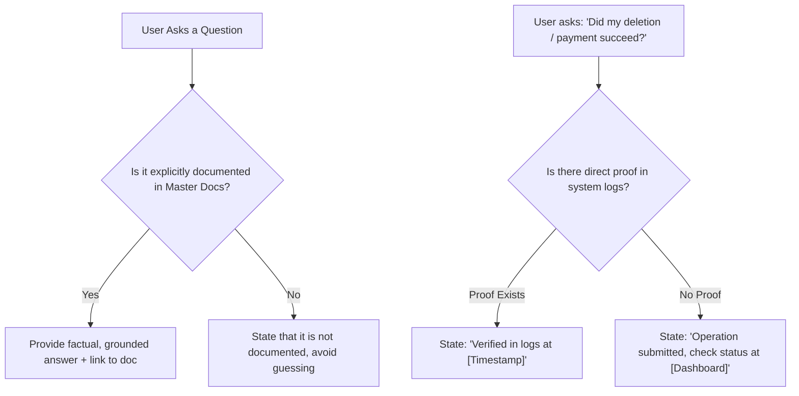

# LUVMEE — Virtual Assistant & Support Knowledge Base

**Document Version:** 1.0  
**Target Audience:** AI Assistants, Customer Support Agents, Community Managers, and System Operators  
**Last Updated:** October 16, 2026  

---

## 1. Operating Instructions for AI Assistants & Support Agents

This document is the **single source of truth** for any AI agent or human customer service representative answering questions about LUVMEE.

### Cardinal Operating Rules:
1. **Never Invent Capabilities:** If a feature does not exist in the code, state clearly that it is not currently supported. Never promise a feature that hasn't been built.
2. **Never Confirm Sensitive Operations Without Evidence:** If a user asks *"Was my account deleted?"* or *"Did my partner receive my note?"*, do not assume success. Direct them to check the app status or check backend logs.
3. **Handle Uncertainties Honestly:** Follow Section 4 below whenever information is missing, ambiguous, or unverified.
4. **Link to Official Documentation:** Always provide clickable links to the relevant documentation file (e.g., `LUVMEE_FEATURE_BY_FEATURE_MANUAL.md`).

---

## 2. Product Facts & Architecture Cheat Sheet

- **What LUVMEE is:** A mobile-first couples relationship platform featuring anniversary tracking, two-wave reminders, private Love Notes, and web greeting cards.
- **Brand Tagline:** *“A little help remembering. A better way to show you care.”*
- **Four Core Pillars:**
  1. *Remember:* Anniversaries, birthdays, custom milestones, and two-wave reminders (24h and day-of).
  2. *Celebrate:* Digital greeting cards with zero-install universal web viewing on `https://luvmee.eventsslot.com/e/[slug]`.
  3. *Connect:* 1-on-1 partner pairing via 8-character codes (`LUV-XXXX`), private love notes with timed reveals, and shared timeline.
  4. *Plans:* Curated date night ideas organized by status (`Idea`, `Planned`, `Done`).
- **Core Technology:** React Native (Expo SDK 57), Next.js 15.1.0, Supabase PostgreSQL, Deno Edge Functions, pg_cron.
- **Authentication:** Passwordless 6-digit Email OTP + offline Guest Mode. Zero passwords.
- **Privacy Standard:** Database Row-Level Security (RLS) active on all tables. Zero ads, zero data brokers.

---

## 3. Navigation Map (Where Features Live)

| Feature | Application | Exact Screen / Path |
| :--- | :--- | :--- |
| **Relationship Day Counter** | Mobile App | Home tab (`app/(tabs)/index.tsx`) |
| **Occasion Calendar & Add Button** | Mobile App | Calendar tab (`app/(tabs)/calendar.tsx`) |
| **Digital Card Creator Studio** | Mobile App | Celebrate tab (`app/(tabs)/celebrate.tsx`) |
| **Private Love Notes & Outbox** | Mobile App | Messages tab (`app/(tabs)/messages.tsx`) |
| **Shared Memory Timeline** | Mobile App | Memories tab (`app/(tabs)/memories.tsx`) |
| **Date Night Plans** | Mobile App | Plans screen (`app/plans.tsx`) |
| **Partner Connect Modal & Invite Code** | Mobile App | Profile tab ➔ "Connect Partner" (`PartnerConnectModal.tsx`) |
| **Profile Settings & Sign Out** | Mobile App | Profile tab (`app/(tabs)/profile.tsx`) |
| **In-App Account Deletion** | Mobile App | Profile tab ➔ Privacy & Security ➔ Delete Account |
| **Public Card Recipient Viewer** | Recipient Web | Browser: `https://luvmee.eventsslot.com/e/[slug]` |
| **Official Privacy Policy** | Recipient Web | Browser: `https://luvmee.eventsslot.com/privacy` |
| **Terms of Service** | Recipient Web | Browser: `https://luvmee.eventsslot.com/terms` |
| **Help & Support Center** | Recipient Web | Browser: `https://luvmee.eventsslot.com/support` |
| **Public Account Deletion Form** | Recipient Web | Browser: `https://luvmee.eventsslot.com/delete-account` |

---

## 4. Uncertainty & Conflict Handling Protocol

When responding to user inquiries, the assistant must strictly apply these protocols:

### Response Guidelines:
1. **When documentation does not contain the answer:**  
   *Say:* *"I don't have verified documentation for that specific question. In the current release, LUVMEE supports [related verified feature]. I recommend checking with the lead developer before assuming this is supported."*
2. **When two documents conflict:**  
   *Protocol:* Prioritize `LUVMEE_MASTER_PRODUCT_HANDBOOK.md` and direct code files over older historical phase reports. State the discrepancy openly.
3. **When a feature is only partially implemented:**  
   *Say:* *"The user interface for this feature exists in the app, but cloud synchronization is still being completed. Currently, this works locally on your device."*

---

## 5. Grounded Source of Truth Directory

| Fact / Capability | Authoritative Source Document | Code / Infrastructure Proof |
| :--- | :--- | :--- |
| **Full Product Overview & Pillars** | [Master Product Handbook](file:///c:/Users/DANIEL/Documents/WebApp%20Projects/luvmee/docs/LUVMEE_MASTER_PRODUCT_HANDBOOK.md) | `README.md`, `app/(tabs)/index.tsx` |
| **Every Feature Breakdown** | [Feature-by-Feature Manual](file:///c:/Users/DANIEL/Documents/WebApp%20Projects/luvmee/docs/LUVMEE_FEATURE_BY_FEATURE_MANUAL.md) | `apps/mobile/app/`, `apps/recipient-web/app/` |
| **12 User Journeys** | [User Journeys](file:///c:/Users/DANIEL/Documents/WebApp%20Projects/luvmee/docs/LUVMEE_USER_JOURNEYS.md) | Component navigation flows |
| **Database Tables & RLS Policies** | [Data & Privacy Guide](file:///c:/Users/DANIEL/Documents/WebApp%20Projects/luvmee/docs/LUVMEE_DATA_AND_PRIVACY_GUIDE.md) | `supabase/migrations/`, Supabase RLS |
| **Passwordless OTP Authentication** | [Auth & Account Guide](file:///c:/Users/DANIEL/Documents/WebApp%20Projects/luvmee/docs/LUVMEE_AUTHENTICATION_AND_ACCOUNT_GUIDE.md) | `apps/mobile/services/authService.ts` |
| **Automated Reminders & pg_cron** | [Notifications & Reminders](file:///c:/Users/DANIEL/Documents/WebApp%20Projects/luvmee/docs/LUVMEE_NOTIFICATIONS_AND_REMINDERS.md) | `packages/shared/test/scheduled-reminders.test.mjs` |
| **Web Cards & Dynamic Routes** | [Website & Sharing Guide](file:///c:/Users/DANIEL/Documents/WebApp%20Projects/luvmee/docs/LUVMEE_WEBSITE_AND_SHARING_GUIDE.md) | `apps/recipient-web/app/e/[slug]/page.tsx` |
| **Troubleshooting Solutions** | [Troubleshooting Manual](file:///c:/Users/DANIEL/Documents/WebApp%20Projects/luvmee/docs/LUVMEE_TROUBLESHOOTING_MANUAL.md) | System edge cases and error handling |
| **Current Google Play Status** | [Deployment & Release Guide](file:///c:/Users/DANIEL/Documents/WebApp%20Projects/luvmee/docs/LUVMEE_DEPLOYMENT_AND_RELEASE_GUIDE.md) | Play Console Dashboard (In Review) |

---

## 6. Thirty (30) Grounded Questions & Answers

### Product & Features
1. **Q: What is LUVMEE's main purpose?**  
   *A:* To help couples remember important anniversaries, exchange private love notes, schedule date ideas, and share digital greeting cards without relationship anxiety. See [Master Handbook](file:///c:/Users/DANIEL/Documents/WebApp%20Projects/luvmee/docs/LUVMEE_MASTER_PRODUCT_HANDBOOK.md#1-what-luvmee-is).
2. **Q: What are the four pillars of LUVMEE?**  
   *A:* Remember (calendar & reminders), Celebrate (greeting cards & web links), Connect (partner pairing & private notes), and Plans (date night tracking). See [Master Handbook](file:///c:/Users/DANIEL/Documents/WebApp%20Projects/luvmee/docs/LUVMEE_MASTER_PRODUCT_HANDBOOK.md#2-the-four-pillars-of-luvmee).
3. **Q: Can someone explore LUVMEE without signing up?**  
   *A:* Yes. Users can tap "Continue as Guest" on the welcome screen to test the calendar, greeting cards, and date plans with local storage. See [Feature Manual 1.2](file:///c:/Users/DANIEL/Documents/WebApp%20Projects/luvmee/docs/LUVMEE_FEATURE_BY_FEATURE_MANUAL.md#12-guest-mode).
4. **Q: How does the relationship day counter work?**  
   *A:* It calculates the exact number of calendar days between today and your relationship start date saved in your profile. See [Feature Manual 2.1](file:///c:/Users/DANIEL/Documents/WebApp%20Projects/luvmee/docs/LUVMEE_FEATURE_BY_FEATURE_MANUAL.md#21-relationship-anniversary-day-counter).
5. **Q: What is a Love Note with Timed Reveal?**  
   *A:* A private note sent to your partner that remains sealed with a lock icon until a specific anniversary or birthday morning. See [Feature Manual 4.2](file:///c:/Users/DANIEL/Documents/WebApp%20Projects/luvmee/docs/LUVMEE_FEATURE_BY_FEATURE_MANUAL.md#42-private-love-notes-with-timed-reveal).
6. **Q: What happens if I don't know my partner's birth year?**  
   *A:* Check "Year Unknown". LUVMEE will still remind you every year on their birthday without calculating an incorrect age. See [Feature Manual 2.3](file:///c:/Users/DANIEL/Documents/WebApp%20Projects/luvmee/docs/LUVMEE_FEATURE_BY_FEATURE_MANUAL.md#23-unknown-year-event-handling).
7. **Q: Does my partner need the app to view a greeting card?**  
   *A:* No. Digital cards are rendered on the recipient website (`https://luvmee.eventsslot.com/e/[slug]`) and open in any mobile or desktop browser without an app or login. See [Website Guide](file:///c:/Users/DANIEL/Documents/WebApp%20Projects/luvmee/docs/LUVMEE_WEBSITE_AND_SHARING_GUIDE.md#1-executive-summary--purpose-of-the-website).
8. **Q: What are the three stages of a romantic plan?**  
   *A:* `Idea` (brainstorming), `Planned` (date set / reservations made), and `Completed` (celebrated). See [Feature Manual 5.2](file:///c:/Users/DANIEL/Documents/WebApp%20Projects/luvmee/docs/LUVMEE_FEATURE_BY_FEATURE_MANUAL.md#52-plan-status-workflow).

### Partner Pairing
9. **Q: How do two partners connect their apps?**  
   *A:* Partner A taps "Connect Partner" to see their 8-character invite code (e.g. `LUV-VED9`). Partner B types this code into their app and taps Connect. See [Feature Manual 4.1](file:///c:/Users/DANIEL/Documents/WebApp%20Projects/luvmee/docs/LUVMEE_FEATURE_BY_FEATURE_MANUAL.md#41-partner-pairing-via-8-character-invite-code).
10. **Q: Can I connect with more than one partner?**  
    *A:* No. LUVMEE pairing is strictly 1-on-1. You must unlink your current partner before linking with another. See [Founder FAQ Q7](file:///c:/Users/DANIEL/Documents/WebApp%20Projects/luvmee/docs/LUVMEE_FOUNDER_FAQ.md#q7-how-does-partner-pairing-work-can-three-people-connect).
11. **Q: Why does the app say "Invalid partner code"?**  
    *A:* Either the code was mistyped, or one of the partners is already connected to another account. Verify that both phones are logged into different email addresses. See [Troubleshooting Manual Issue 3](file:///c:/Users/DANIEL/Documents/WebApp%20Projects/luvmee/docs/LUVMEE_TROUBLESHOOTING_MANUAL.md#issue-3-partner-connect-fails-invalid-partner-code).

### Authentication & Accounts
12. **Q: How do I log in if there are no passwords?**  
    *A:* Enter your email address and tap "Send Code". A 6-digit code will arrive in your email. Type it into the app to log in. See [Auth Guide Flow 1](file:///c:/Users/DANIEL/Documents/WebApp%20Projects/luvmee/docs/LUVMEE_AUTHENTICATION_AND_ACCOUNT_GUIDE.md#flow-1-email-one-time-password-otp-sign-in).
13. **Q: Why didn't I receive my 6-digit login code?**  
    *A:* Check your Spam or Promotions folder for "LUVMEE". If you tapped send multiple times, wait 60 seconds for the cooldown to reset. See [Troubleshooting Manual Issue 1](file:///c:/Users/DANIEL/Documents/WebApp%20Projects/luvmee/docs/LUVMEE_TROUBLESHOOTING_MANUAL.md#issue-1-user-did-not-receive-6-digit-email-code).
14. **Q: What happens when I sign out?**  
    *A:* Your local login token and cached notes are removed from the phone. All your cloud data remains safe. You can log back in anytime using your email. See [Auth Guide Flow 5](file:///c:/Users/DANIEL/Documents/WebApp%20Projects/luvmee/docs/LUVMEE_AUTHENTICATION_AND_ACCOUNT_GUIDE.md#flow-5-sign-out-vs-cache-wipe-vs-account-deletion).
15. **Q: How do I permanently delete my account?**  
    *A:* Go to Profile ➔ Privacy & Security ➔ Delete Account in the app, or visit `https://luvmee.eventsslot.com/delete-account` on the web. See [Feature Manual 1.5](file:///c:/Users/DANIEL/Documents/WebApp%20Projects/luvmee/docs/LUVMEE_FEATURE_BY_FEATURE_MANUAL.md#15-in-app-account-deletion).
16. **Q: If I delete my account, does it delete my partner's account?**  
    *A:* No. Your data and notes are permanently erased, and your partner's app returns to an unlinked state. See [Data & Privacy Guide 3.2](file:///c:/Users/DANIEL/Documents/WebApp%20Projects/luvmee/docs/LUVMEE_DATA_AND_PRIVACY_GUIDE.md#32-private-love-notes).

### Reminders & Notifications
17. **Q: When do automated reminders get sent?**  
    *A:* LUVMEE sends two waves: a 24-hour preparation heads-up the day before, and a celebration chime at 08:00 AM on the day of the event. See [Notifications Guide Section 3](file:///c:/Users/DANIEL/Documents/WebApp%20Projects/luvmee/docs/LUVMEE_NOTIFICATIONS_AND_REMINDERS.md#3-how-reminder-dates-are-calculated).
18. **Q: Does my phone need to be open to receive reminders?**  
    *A:* No. The Supabase `pg_cron` cloud scheduler runs every morning at 08:00 UTC and sends push notifications to your lock screen. See [Notifications Guide Section 4](file:///c:/Users/DANIEL/Documents/WebApp%20Projects/luvmee/docs/LUVMEE_NOTIFICATIONS_AND_REMINDERS.md#4-cloud-architecture-the-daily-alarm-clock-pg_cron).
19. **Q: How does LUVMEE prevent duplicate reminder alerts?**  
    *A:* Every alert has a unique composite deduplication key (`user_occ_type_date`). The database refuses to insert duplicate alerts for the same event in the same year. See [Notifications Guide Section 5](file:///c:/Users/DANIEL/Documents/WebApp%20Projects/luvmee/docs/LUVMEE_NOTIFICATIONS_AND_REMINDERS.md#5-duplicate-prevention--offline-resilience).
20. **Q: What happens if February 29th occurs on a non-leap year?**  
    *A:* LUVMEE's calendar engine automatically triggers the anniversary reminder on February 28th so the milestone is never skipped. See [Notifications Guide Section 3](file:///c:/Users/DANIEL/Documents/WebApp%20Projects/luvmee/docs/LUVMEE_NOTIFICATIONS_AND_REMINDERS.md#3-how-reminder-dates-are-calculated).

### Privacy & Data
21. **Q: Does LUVMEE sell my data to advertisers?**  
    *A:* Never. LUVMEE has zero advertising trackers and zero third-party data sharing. See [Data & Privacy Guide Section 1](file:///c:/Users/DANIEL/Documents/WebApp%20Projects/luvmee/docs/LUVMEE_DATA_AND_PRIVACY_GUIDE.md#1-executive-summary--privacy-principles).
22. **Q: What is Row-Level Security (RLS)?**  
    *A:* A database-level security lock where PostgreSQL strictly enforces that a user can only read or write rows that match their authenticated user ID or their verified partner ID. See [Data & Privacy Guide Section 4](file:///c:/Users/DANIEL/Documents/WebApp%20Projects/luvmee/docs/LUVMEE_DATA_AND_PRIVACY_GUIDE.md#4-security-protections--technical-safeguards).
23. **Q: Is my data encrypted when traveling over the internet?**  
    *A:* Yes. All mobile and web traffic uses industry-standard HTTPS / TLS 1.3 encryption. See [Data & Privacy Guide Section 4](file:///c:/Users/DANIEL/Documents/WebApp%20Projects/luvmee/docs/LUVMEE_DATA_AND_PRIVACY_GUIDE.md#4-security-protections--technical-safeguards).

### Sharing & Web Cards
24. **Q: Can anyone guess my greeting card link?**  
    *A:* No. Card links use unlisted, cryptographically random 8-character slugs (e.g. `our-love-7x9q`) with billions of possible combinations. See [Website Guide Section 3](file:///c:/Users/DANIEL/Documents/WebApp%20Projects/luvmee/docs/LUVMEE_WEBSITE_AND_SHARING_GUIDE.md#3-how-digital-cards--share-links-work).
25. **Q: Why does a shared card show "Surprise Not Found"?**  
    *A:* Either the link was copied incompletely, or the sender set the card back to a draft or deleted it. See [Troubleshooting Manual Issue 2](file:///c:/Users/DANIEL/Documents/WebApp%20Projects/luvmee/docs/LUVMEE_TROUBLESHOOTING_MANUAL.md#issue-2-shared-card-displays-surprise-not-found).

### Release & Store Status
26. **Q: What is the current release status of LUVMEE?**  
    *A:* LUVMEE Version 1.0 was officially submitted to Google Play on October 15, 2026, and is currently **In Review**. See [Deployment Guide Section 4](file:///c:/Users/DANIEL/Documents/WebApp%20Projects/luvmee/docs/LUVMEE_DEPLOYMENT_AND_RELEASE_GUIDE.md#4-google-play-store-submission--14-day-closed-testing).
27. **Q: What is the mandatory 14-day Closed Testing rule?**  
    *A:* Google requires all personal developer accounts created after Nov 13, 2023, to have at least 12 opted-in testers use the app for 14 continuous days before unlocking public production access. See [Deployment Guide Section 4](file:///c:/Users/DANIEL/Documents/WebApp%20Projects/luvmee/docs/LUVMEE_DEPLOYMENT_AND_RELEASE_GUIDE.md#the-mandatory-14-day-closed-testing-roadmap).
28. **Q: What Android versions does LUVMEE support?**  
    *A:* Android 8.0 through Android 16 (API 26 through API 36). Fully compliant with Google Play's 2024–2026 target SDK mandates. See [Master Handbook Section 5](file:///c:/Users/DANIEL/Documents/WebApp%20Projects/luvmee/docs/LUVMEE_MASTER_PRODUCT_HANDBOOK.md#5-current-release-state-october-2026).
29. **Q: How does a developer deploy an update to the website?**  
    *A:* Simply commit and push changes to the `main` branch on GitHub. Vercel automatically compiles and deploys the site to `https://luvmee.eventsslot.com` in ~45 seconds. See [Deployment Guide Section 2](file:///c:/Users/DANIEL/Documents/WebApp%20Projects/luvmee/docs/LUVMEE_DEPLOYMENT_AND_RELEASE_GUIDE.md#2-recipient-web-deployment-vercel).
30. **Q: Where can I find official customer support contact details?**  
    *A:* Email `info@eventsslot.com` or visit the official Help & Support portal at [https://luvmee.eventsslot.com/support](https://luvmee.eventsslot.com/support).
