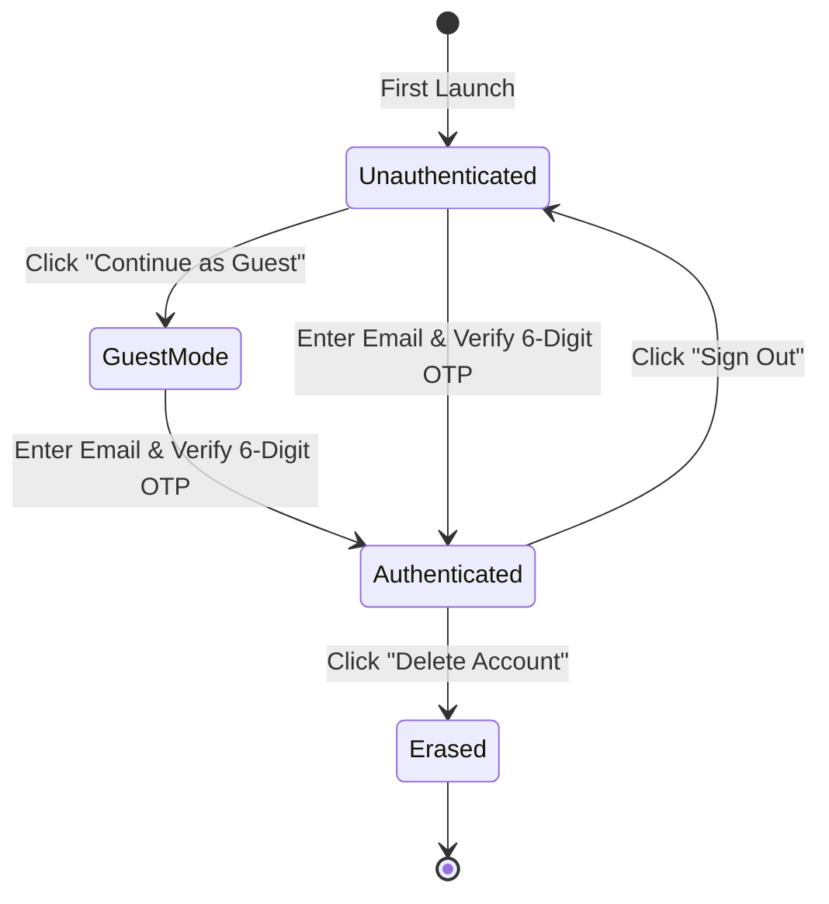
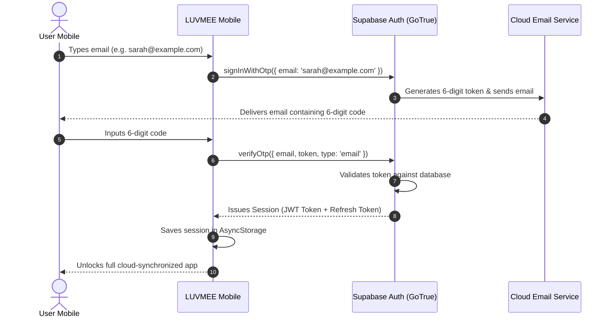
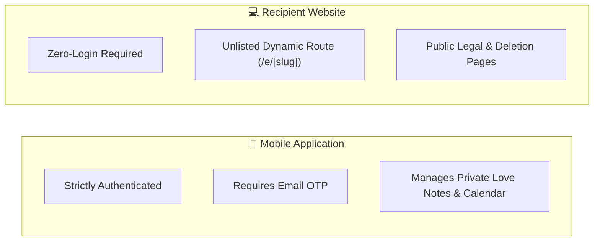

# LUVMEE — Authentication & Account Management Guide

**Document Version:** 1.0  
**Target Audience:** Founder, Engineers, QA Testers, and Customer Support  
**Last Updated:** October 16, 2026  

---

## 1. Executive Summary & Design Rationale

Authentication in LUVMEE is designed around two core principles: **Zero Friction** and **Ironclad Privacy**.

Traditional password systems create unnecessary headaches for couples:
- Forgotten passwords cause frustration and app abandonment.
- Weak passwords introduce security vulnerabilities.
- Password reset emails get flagged as spam.

To eliminate this friction, LUVMEE uses a **Passwordless Email OTP (One-Time Password)** system powered by Supabase Auth, complemented by a **Zero-Barrier Guest Mode** for new users exploring the app.

---

## 2. Authentication State Machine

The mobile application operates across three distinct user states:

### The Three States Explained:
1. **Unauthenticated:** The user sees the welcome onboarding screen. No personal data is stored.
2. **Guest Mode:** The user has full offline access to explore the Calendar, greeting card studio, and sample relationship widgets. Data is saved exclusively in the phone's memory (`AsyncStorage`). No data is sent to the cloud.
3. **Authenticated:** The user is logged in via their verified email address. Their profile, partner connection, love notes, occasions, and timeline are continuously synchronized with the Supabase cloud backend.

---

## 3. Deep Dive into Authentication Flows

---

### Flow 1: Email One-Time Password (OTP) Sign-In

#### Step-by-Step Walkthrough:
1. **Email Submission:** User enters their email address and taps *"Send 6-Digit Code"*.
2. **Rate Limiting:** A 60-second cooldown timer activates on the screen to prevent accidental spam or abuse.
3. **Email Delivery:** Supabase generates a single-use 6-digit numeric token and sends it using its transactional email service. The email template contains the token variable: `{{ .Token }}`.
4. **Auto-Verification:** When the user enters the 6th digit, the app automatically triggers `supabase.auth.verifyOtp()`.
5. **Session Grant:** On verification, Supabase issues a cryptographically signed **JSON Web Token (JWT)** that authenticates the user for all future database requests.

#### What Can Go Wrong:
- *Email delay:* Corporate firewalls or aggressive spam filters can delay emails by 1 to 2 minutes. The app provides a *"Resend Code"* button after 60 seconds.
- *Typo in email:* If the user misspells their email, they can tap *"Change Email"* to retype it.
- *Expired token:* Codes expire after 60 minutes for security.

---

### Flow 2: Guest Mode (Zero-Barrier Exploration)

- **Purpose:** Let users experience the value of LUVMEE before asking for their email.
- **How it Works:**
  - Tapping *"Continue as Guest"* sets a local flag: `@luvmee:guest_mode = true` in the device's private storage.
  - The app displays sample relationship data (e.g. sample anniversary, sample memories) so the user can interact with the UI immediately.
- **Upgrading from Guest to Authenticated:**
  - Whenever a guest user taps a cloud-dependent action (such as *"Connect Partner"* or *"Share Card"*), a bottom sheet appears:  
    *"Create a free account to link with your partner and save your memories forever."*
  - Entering their email seamlessly upgrades their guest session to a permanent cloud account without losing locally entered data.

---

### Flow 3: Google Sign-In & OAuth Architecture

- **Status in Codebase:** The codebase contains native OAuth callback infrastructure in `apps/mobile/app/auth/callback.tsx` and deep linking schema `luvmee://auth/callback`.
- **How It Works:**
  1. User taps *"Sign in with Google"*.
  2. The app opens a secure in-app browser session using `expo-web-browser`.
  3. User approves access on Google's consent screen.
  4. Google redirects back to the Supabase OAuth URL: `https://<project-id>.supabase.co/auth/v1/callback`.
  5. Supabase exchanges the Google authorization code for a session and redirects to the app via deep link: `luvmee://auth/callback#access_token=...`.
  6. The mobile app captures the deep link, extracts the session tokens, and logs the user in.
- **Production Configuration Rule:** In the Supabase Dashboard, the **Site URL** must be set to `https://luvmee.eventsslot.com`, and **Redirect URLs** must include `luvmee://auth/callback`.

---

### Flow 4: Session Persistence & Auto-Refresh

How does a user stay logged in when they close the app?

1. **Storage:** When logged in, the app securely stores two tokens in `AsyncStorage`:
   - **Access Token (JWT):** A short-lived token (valid for 1 hour) that proves identity on every database query.
   - **Refresh Token:** A long-lived, encrypted key used solely to request a fresh Access Token when the old one expires.
2. **Auto-Refresh:** The Supabase JavaScript client automatically runs in the background. When an Access Token is near expiration, it silently uses the Refresh Token to obtain a new Access Token without interrupting the user.
3. **App Re-Opening:** When the user opens LUVMEE after days or weeks, the app reads the cached tokens, verifies them with Supabase in the background, and displays the user's dashboard instantly.

---

### Flow 5: Sign-Out vs. Cache Wipe vs. Account Deletion

It is essential to distinguish between these three very different actions:

| Action | What Happens to Local Device | What Happens to Cloud Database | Can the User Return? |
| :--- | :--- | :--- | :---: |
| **Sign Out** | Local session tokens and cached notes are wiped from phone storage. | Database records remain 100% intact. Partner connection remains active. | **Yes.** Entering email and OTP restores all data instantly. |
| **Clear App Cache** | Temporary image files and offline caches are deleted from the phone. | Database records remain 100% intact. User stays logged in. | **Yes.** App re-downloads data from cloud on next open. |
| **Delete Account** | All local storage is wiped, and user is returned to onboarding. | **Permanent Purge:** Profile, notes, occasions, memories, and photos are permanently erased from the server. | **No.** Account is destroyed and cannot be recovered. |

---

## 4. Mobile App vs. Recipient Web Authentication Differences

A common question from founders is: *"Why doesn't the recipient website require a login?"*

Here is the architectural distinction:

- **Mobile App:** This is the private control center. Both partners must authenticate so the database knows whose relationship space is being viewed.
- **Recipient Web App:** This is a zero-install greeting card display. Requiring an account to read an anniversary card creates massive friction. Instead, each card has a random, unlisted web address (e.g., `https://luvmee.eventsslot.com/e/our-love-xyz`). Anyone holding that exact link can view the card without an account.
