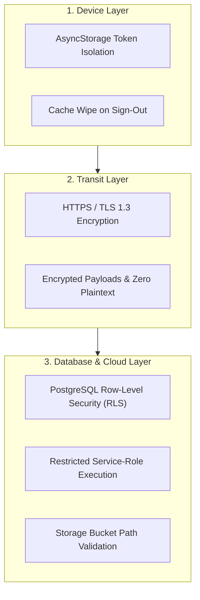

# LUVMEE — Data, Privacy & Security Guide

**Document Version:** 1.0  
**Target Audience:** Founder, Security Auditors, Legal Counsel, and Engineering  
**Last Updated:** October 16, 2026  

---

## 1. Executive Summary & Privacy Principles

LUVMEE is built on a foundational philosophy: **Romantic relationships are deeply intimate and must be protected with uncompromising privacy.**

Unlike social media platforms that monetize user attention, sell behavioral data to advertisers, or track users across the web, LUVMEE operates under strict data minimization rules:
1. **Zero Advertising Trackers:** The codebase contains zero advertising SDKs, zero Facebook Pixel tracking, and zero commercial data broker libraries.
2. **Strict Partner Isolation:** Every private love note, anniversary date, and memory photo is protected by database-level Row-Level Security (RLS). A stranger can never read a couple's private data.
3. **Encryption in Transit:** All communications between mobile phones, the website, and cloud servers are encrypted using standard **HTTPS / TLS 1.3**.
4. **Complete Right to Erasure:** Users can permanently delete their accounts and all associated data at any time via in-app settings or the public web self-service portal.

---

## 2. Comprehensive Data Inventory Matrix

Below is the verified breakdown of every category of information handled by LUVMEE:

| Data Category | Specific Fields Handled | Why LUVMEE Collects It | Storage Location | Access Controls (RLS) | Public vs. Private | Retention on Account Deletion |
| :--- | :--- | :--- | :--- | :--- | :---: | :--- |
| **Account Credentials** | Email address, User UUID, signup timestamp | Account identity and sending passwordless OTP codes | Supabase `auth.users` | Accessible only to system auth engine | **Private** | Permanently deleted via Admin API |
| **User Profile** | Display name, partner nickname, anniversary date | Personalizing dashboard and calculating day counter | `public.profiles` | Owner and verified paired partner only | **Private** | Row deleted via cascading foreign key |
| **Partner Pairing** | Inviter UUID, Invitee UUID, invite code, status | Linking two accounts into a synchronized couple space | `public.partner_connections` | Exclusively the two connected users | **Private** | Row deleted via cascading foreign key |
| **Love Notes** | Note content text, sender ID, receiver ID, reveal date | Delivering private intimate notes and surprise messages | `public.love_notes` | Designated sender and receiver only | **Private** | Rows deleted via cascading foreign key |
| **Occasions & Milestones**| Title, date, category, unknown year flag, reminder flags | Displaying calendar events and triggering reminder alerts | `public.occasions` | Owner and verified partner | **Private** | Rows deleted via cascading foreign key |
| **Shared Memories** | Story text, date, photo URL, couple ID | Chronological relationship timeline feed | `public.timeline_memories` | Paired couple only | **Private** | Rows deleted, photos purged from bucket |
| **Digital Cards** | Title, template ID, letter message, custom slug | Generating shareable interactive web greeting cards | `public.experiences` | Public to anyone holding the unique link | **Public (Unlisted)**| Deleted on account removal |
| **Date Plans** | Plan title, notes, status (`Idea`/`Done`), date | Tracking date night ideas and restaurant wishlists | `public.personal_plans` | Owner and verified partner | **Private** | Rows deleted via cascading foreign key |
| **Device Push Tokens** | Expo push token string, OS platform (Android/iOS) | Delivering lock-screen notification banners | `public.device_tokens` | App backend dispatcher | **Private** | Token purged on sign-out or deletion |
| **Guest Data** | Local preferences, sample occasion markers | Exploring the app prior to account registration | Physical Device `AsyncStorage` | None (On-device only) | **Private (Device)** | Cleared when app is uninstalled |

---

## 3. Deep Dive into Data Categories

---

### 3.1 Account Credentials & Authentication
- **What is collected:** User's email address and system-generated unique ID (`UUID`).
- **Why it is needed:** To identify the user, authenticate them via 6-digit email codes, and associate their relationship records with their identity.
- **Where it is stored:** Supabase's hardened internal schema: `auth.users`.
- **Who can access it:** Only Supabase Auth internal services. The database connection string used by mobile devices cannot read the `auth.users` table directly.
- **What happens on sign-out:** The active JWT session token on the phone is invalidated and erased from local device storage.
- **What happens on account deletion:** The user account is permanently deleted from `auth.users` using the Supabase Service Role Admin API.

---

### 3.2 Private Love Notes
- **What is collected:** Private romantic text messages, mood tags (e.g. `Warm`, `Deep`), timestamps, and optional reveal dates.
- **Why it is needed:** Enables partners to exchange intimate thoughts with scheduled surprise reveals.
- **Where it is stored:** `public.love_notes`.
- **Access Control (Row-Level Security):**
  ```sql
  -- Verified RLS Policy on public.love_notes
  CREATE POLICY "Couples can read their own love notes" 
  ON public.love_notes FOR SELECT 
  USING (auth.uid() = sender_id OR auth.uid() = receiver_id);
  ```
  This rule is enforced by the PostgreSQL database engine itself. Even if someone writes a custom script or tries to query the database, PostgreSQL blocks any request where the requester's ID does not match the note's sender or receiver.
- **What happens on account deletion:** All love notes sent by or addressed to the user are permanently purged.

---

### 3.3 Occasions, Birthdays & Anniversaries
- **What is collected:** Event title, date, category tag, recurring flag (`is_recurring`), and reminder preferences.
- **Why it is needed:** Powers the relationship calendar and automated reminder notifications.
- **Unknown Year Privacy:** If a user does not know a birth year, the system stores a normalized placeholder (`1900-MM-DD`). The reminder engine processes the month and day without guessing or exposing personal birth years.
- **Access Control:** Only the user who created the occasion and their paired partner can view or edit the record.

---

### 3.4 Public Digital Greeting Cards
- **What is collected:** Card title, recipient name, sender's love letter text, visual theme ID, and a randomly generated unlisted slug (e.g., `our-anniversary-7x9q`).
- **Why it is needed:** Allows recipients to open and view interactive cards on any web browser without downloading the mobile app.
- **Public vs. Private:**
  - Digital greeting cards are **Publicly Accessible via Unlisted Link**. Anyone who possesses the exact link URL (`https://luvmee.eventsslot.com/e/[slug]`) can open the page.
  - Senders should be informed that sharing links should only be sent directly to their intended recipient via secure messaging (e.g., WhatsApp, iMessage, SMS).
- **What happens on account deletion:** All cards created by the user are deleted, and subsequent visits to the link return HTTP 404 ("Surprise Not Found").

---

### 3.5 Device Push Tokens & Notification Events
- **What is collected:** An anonymous push token string generated by the operating system (e.g., `ExponentPushToken[xxxxxxxxxxxx]`).
- **Why it is needed:** Enables the cloud reminder service to instruct Apple and Google servers to deliver a chime or banner to the user's phone lock screen.
- **Privacy Protections:** The push token is an opaque string that contains zero personal data, GPS location, or device hardware serial numbers. It can only be used to send push alerts through Expo's gateway.

---

## 4. Security Protections & Technical Safeguards



### 1. Row-Level Security (RLS)
Every table in the LUVMEE database has PostgreSQL Row-Level Security **enabled by default**. A user with an active login token can only view rows that explicitly match their user UUID or their paired partner's UUID. Database queries that do not match these criteria return empty result sets.

### 2. Encryption in Transit
Every communication between the mobile app, recipient website, and Supabase cloud operates exclusively over **TLS 1.3** encrypted connections. Plaintext HTTP is strictly rejected.

### 3. Protection of Secrets
- Public configuration values (such as `EXPO_PUBLIC_SUPABASE_URL` and `EXPO_PUBLIC_SUPABASE_ANON_KEY`) are safe to distribute because they are restricted by Row-Level Security.
- The master administrative secret (`SUPABASE_SERVICE_ROLE_KEY`) is stored **only** in secure server-side cloud runtimes (Vercel serverless environment and Supabase Edge Functions). It is never compiled into the mobile application package.

---

## 5. Account Deletion & Data Retention Policy

To comply with Google Play's May 2024 Account Deletion Requirement and global data privacy standards (GDPR / CCPA):

### How a User Can Delete Their Data:
1. **In-App:** Profile ➔ Privacy & Security ➔ Delete My Account.
2. **Public Web:** Anyone can visit [https://luvmee.eventsslot.com/delete-account](https://luvmee.eventsslot.com/delete-account) and submit an email verification request.

### What Actually Gets Deleted:
When an account deletion request executes:
1. `public.love_notes`: All notes sent by or addressed to the user are purged.
2. `public.timeline_memories`: All shared timeline stories are deleted.
3. `public.occasions`: All calendar occasions and reminders are deleted.
4. `public.personal_plans`: All date ideas are purged.
5. `public.partner_connections`: The pairing record is dissolved, returning the partner to an unlinked state.
6. `public.profiles`: The user profile row is deleted.
7. `Supabase Storage`: All uploaded photos in the user's storage folder are permanently deleted.
8. `auth.users`: The user's authentication identity and login credentials are permanently removed from the Supabase authentication server.

### Backup Retention:
Database point-in-time recovery logs maintained by cloud infrastructure providers are typically overwritten within 7 to 30 days as part of standard rolling backup cycles. Once the production database scrub executes, the user's data cannot be queried or restored.
