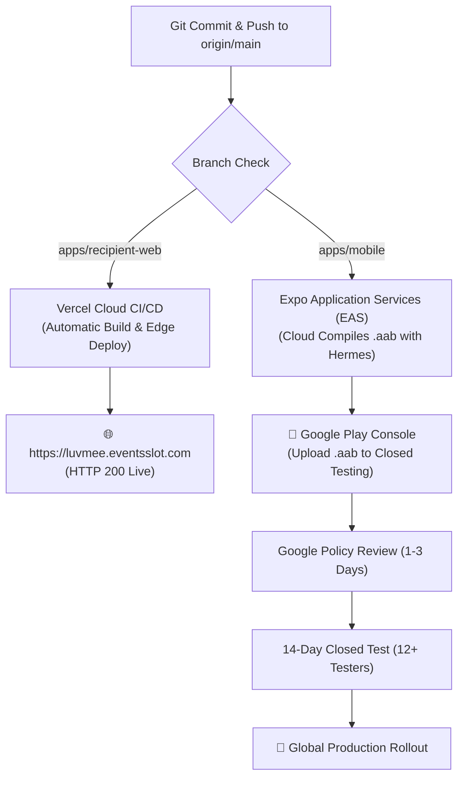
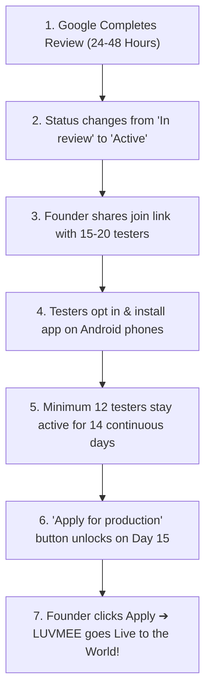

# LUVMEE — Deployment & Release Guide

**Document Version:** 1.0  
**Target Audience:** Founder, Release Managers, DevOps Engineers, and Mobile Developers  
**Last Updated:** October 16, 2026  

---

## 1. Executive Release Overview

Publishing LUVMEE to production involves two separate release pipelines:
1. **The Recipient Website (`apps/recipient-web`):** Continuously deployed to **Vercel** at `https://luvmee.eventsslot.com`.
2. **The Mobile Application (`apps/mobile`):** Built as an **Android App Bundle (`.aab`)** via **EAS Build** and published through **Google Play Console**.



---

## 2. Recipient Web Deployment (Vercel)

### Pipeline Architecture:
- **Hosting Platform:** Vercel Global Edge Network.
- **Production Domain:** [https://luvmee.eventsslot.com](https://luvmee.eventsslot.com)
- **Automatic Trigger:** Every `git push origin main` automatically triggers a production deployment.
- **Build Command:** `npm run build:shared && npm run build:web`
- **Output:** Next.js 15.1.0 App Router static and dynamic routes.

### How to Deploy Web Updates:
1. Stage and commit your changes in Git:
   ```bash
   git commit -am "feat: update legal copy or card template"
   ```
2. Push directly to the `main` branch:
   ```bash
   git push origin main
   ```
3. Vercel automatically detects the push, builds the project in ~45 seconds, and updates `https://luvmee.eventsslot.com` with zero downtime.

### Rollback Procedure (Vercel Instant Rollback):
If a web deployment introduces a bug:
1. Log into [vercel.com](https://vercel.com).
2. Navigate to project: **luvmee**.
3. Under **Deployments**, locate the previous successful deployment.
4. Click the three dots `...` ➔ **Instant Rollback**.
5. The live domain points to the previous working build in 2 seconds.

---

## 3. Mobile Android Build & Release (EAS Build)

Google Play strictly prohibits `.apk` files for production apps. All submissions must be compiled as signed **Android App Bundles (`.aab`)**.

### Build Profiles (`apps/mobile/eas.json`):
- **`preview`:** Compiles a standalone `.apk` for internal testing on developer phones without going through the Play Store.
- **`production`:** Compiles an optimized, Hermes-bytecoded `.aab` signed with the official cloud keystore for Google Play Store publication.

---

### Step-by-Step Android Production Build:

#### 1. Increment Version Code (Crucial!)
Google Play requires that every new `.aab` upload has a strictly higher integer `versionCode`.
Before building, open `apps/mobile/app.json` and increase `versionCode`:
```json
"android": {
  "package": "com.officialkid.luvmee",
  "versionCode": 2
}
```

#### 2. Run the EAS Production Build Command
Run this command from the `apps/mobile` directory:
```bash
cd "c:\Users\DANIEL\Documents\WebApp Projects\luvmee\apps\mobile"
npx eas-cli build --platform android --profile production --no-wait --non-interactive
```

#### 3. What Happens During the Build:
1. EAS packages your project files and uploads them to Expo's build cloud.
2. EAS automatically signs the package using your existing cloud keystore:  
   `Build Credentials kli75Ms7Ws (default)`.
3. Expo cloud servers compile the React Native binary into an optimized `.aab`.
4. When complete, EAS outputs a download link (e.g., `application-xxxxxxxx.aab`).

---

## 4. Google Play Store Submission & 14-Day Closed Testing

### Status of Version 1.0 (Current State):
- **Status:** **IN REVIEW** by Google Play (Submitted October 15, 2026).
- **Target Category:** `Lifestyle` (exempt from CSAE social-network filing).
- **Content Rating:** Everyone / PEGI 3.
- **Target Audience:** 18 and over.
- **Privacy Policy:** `https://luvmee.eventsslot.com/privacy`.
- **Account Deletion Portal:** `https://luvmee.eventsslot.com/delete-account`.

---

### The Mandatory 14-Day Closed Testing Roadmap:

Google Play requires all personal developer accounts created after November 2023 to complete a 14-day closed test before public production access is granted:



#### Detailed Execution Steps for Closed Testing:
1. **Wait for Approval Email:** Google will email you: *"Your update is live on Google Play"*.
2. **Retrieve the Testing Link:**  
   In Google Play Console ➔ **Release** ➔ **Testing** ➔ **Closed testing** ➔ **Testers** tab ➔ Scroll to bottom ➔ Copy **"Join on Android"** link:  
   `https://play.google.com/apps/testing/com.officialkid.luvmee`.
3. **Share Link with Testers:** Send the link to the 15–20 individuals whose emails were added to your tester list.
4. **Tester Action:** Testers must click the link, tap *"Become a tester"*, and install the app from Google Play.
5. **Dashboard Monitoring:** On the Console Dashboard, watch the counter: `X testers currently opted-in`. Ensure this number stays **at or above 12** for the entire 14 days.
6. **Apply for Production:** On Day 15, click the blue **"Apply for production"** button. Complete the brief 5-question feedback form, and your app will be published publicly worldwide!

---

## 5. Post-Release Monitoring & Crash Reporting

Once LUVMEE is live:
1. **Google Play Console ➔ Quality ➔ Android vitals:**  
   Monitor Crash rate and ANR (Application Not Responding) rate. Google requires both to stay below the bad behavior threshold (Crash < 1.09%, ANR < 0.47%).
2. **User Ratings & Reviews:**  
   Google Play Console ➔ **Grow** ➔ **Ratings and reviews**. Respond promptly to user feedback.
3. **Supabase Performance:**  
   Monitor database storage and authentication requests in the Supabase Dashboard.
