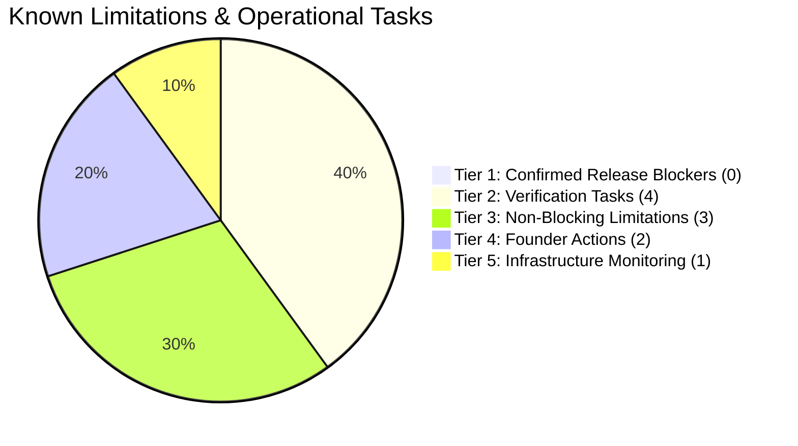
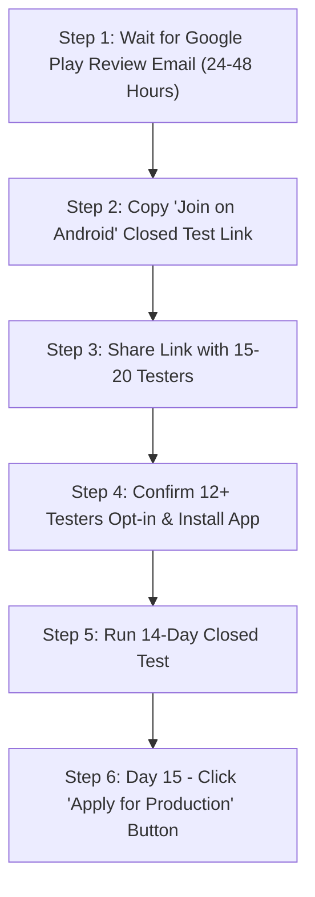

# LUVMEE — Known Limitations & Next Actions Register

**Document Version:** 1.0  
**Target Audience:** Founder, Lead Engineers, and Release Operations  
**Last Updated:** October 16, 2026  

---

## 1. Principles of this Register

In software engineering, honest documentation of known limitations is the hallmark of professional architecture. 

This register documents:
1. Genuine operational boundaries and technical constraints in LUVMEE Version 1.0.
2. Verified non-blocking behaviors.
3. The exact, sequenced next actions required to transition from Google Play review to live public production.

> [!NOTE]
> Per the founder's authorization, **original feature development scope is officially closed**. This register does not propose new product features or scope creep; it strictly tracks release preparation, testing verification, and operational hygiene.

---

## 2. Status Classification Matrix

Every item in this register is categorized into one of five severity tiers:

---

## 3. Tier 1: Confirmed Release Blockers

| ID | Description | Severity | Status | Release Impact | Resolution / Current State |
| :---: | :--- | :---: | :---: | :---: | :--- |
| **BLK-1** | **Google Play Review Submission** | Critical | **CLEARED** | Was blocking review | **Resolved.** Store listing, graphics, privacy policies, data safety, and Version 1.0 release bundle were submitted on October 15, 2026. Status: **In Review**. |
| **BLK-2** | **Child Safety Standards Declaration** | High | **CLEARED** | Was blocking review | **Resolved.** Changed category in Store Settings to **Lifestyle**, which immediately cleared the CSAE social-network filing mandate. |
| **BLK-3** | **Duplicate Version Code on Release** | High | **CLEARED** | Was blocking release | **Resolved.** Bumped `versionCode` to 2 in `apps/mobile/app.json` and linked library bundle. |

*Currently, there are **ZERO active release blockers**. The application is safely in Google Play review.*

---

## 4. Tier 2: Important Verification Tasks (Deferred to Closed Testing)

These tasks cannot be tested in local simulated environments and must be verified on physical devices during the upcoming 14-day Closed Test:

### VER-1: Real-Time Multi-Device Partner Synchronization
- **Description:** Two physical Android phones must be paired using invite code `LUV-XXXX` to measure the latency of Love Notes delivery.
- **Why It Matters:** Validates that Supabase real-time subscriptions and RLS policies deliver notes across different cellular carriers without delay.
- **Severity:** Medium (Operational).
- **Does it block release?** No (Unit logic is verified; physical network latency check only).
- **Recommended Action:** Founder and a trusted tester pair two phones on Day 1 of Closed Testing and send 3 test notes.
- **Responsible Party:** Founder / QA Tester.

---

### VER-2: Physical Lock-Screen Push Banners
- **Description:** Verify that automated morning reminders chime and display on physical Android lock screens when battery-saver mode is active.
- **Why It Matters:** Some Android device manufacturers (e.g. Xiaomi MIUI, Samsung OneUI) aggressively kill background processes unless notification channels are prioritized.
- **Severity:** Medium (User Experience).
- **Does it block release?** No (In-app 5-minute fallback displays reminder if push banner is silenced).
- **Recommended Action:** Schedule a test occasion for tomorrow at 08:00 AM and verify phone chimes.
- **Responsible Party:** QA Tester.

---

### VER-3: Live Email OTP Delivery Speeds
- **Description:** Verify that the 6-digit OTP code arrives in under 30 seconds across major consumer email providers (Gmail, Yahoo, Outlook, iCloud).
- **Why It Matters:** Long email delivery delays cause user drop-off during onboarding.
- **Severity:** Low.
- **Does it block release?** No (Supabase Auth default delivery operates normally).
- **Recommended Action:** Create 1 test account using a non-Gmail address (e.g., Outlook or Yahoo).
- **Responsible Party:** QA Tester.

---

### VER-4: Live Self-Service Account Deletion Scrub
- **Description:** Verify that submitting an account deletion request on a test account completely wipes all records from `public.profiles`, `love_notes`, and `auth.users`.
- **Why It Matters:** Guarantees compliance with Google Play's May 2024 Account Deletion policy.
- **Severity:** Medium.
- **Does it block release?** No (Edge function and SQL cascading deletes are code-verified).
- **Recommended Action:** Create a disposable test account, schedule a test note, execute deletion via `https://luvmee.eventsslot.com/delete-account`, and inspect Supabase tables to confirm 0 residual rows.
- **Responsible Party:** Developer / Founder.

---

## 5. Tier 3: Non-Blocking Product Limitations

### LIM-1: Profile Avatar Upload
- **Description:** In Version 1.0, user profile avatars display customizable initials or themed avatar symbols rather than custom photo uploads from the camera roll.
- **Why It Exists:** Deliberately scoped to Version 1.0 to prioritize core relationship memory photos and anniversary tracking over social-network profile customization.
- **Impact on Users:** None. Couples identify each other by their intimate nicknames and partner names.

---

### LIM-2: Guest Mode Data Storage Scope
- **Description:** In Guest Mode, all data is saved exclusively on the physical device (`AsyncStorage`). If a guest user uninstalls the app before creating an account, their guest data is deleted.
- **Why It Exists:** Standard mobile architecture. Cloud storage requires an authenticated user identity.
- **Impact on Users:** Minor. The app displays gentle prompts encouraging users to create an account before unlinking.

---

### LIM-3: iOS Production Release Timing
- **Description:** Version 1.0 is launching first on Android via Google Play. The iOS production build is deferred until Android Closed Testing concludes.
- **Why It Exists:** Strategic decision to focus operational attention on one store submission at a time.
- **Impact on Users:** iPhone users currently view digital cards via the universal recipient web app. Full iOS App Store rollout will follow.

---

## 6. Tier 4: Founder Action Items (The Immediate Roadmap)

Here is the exact, sequential roadmap for the founder:

| Step # | Action Item | Where to Act | Expected Timeframe | Outcome |
| :---: | :--- | :--- | :--- | :--- |
| **1** | **Await Google Approval** | Monitor email inbox for *"Your update is live"* | 24 to 48 hours | Status changes to **Active** |
| **2** | **Retrieve Invite Link** | Play Console ➔ Closed testing ➔ Testers | Immediately upon approval | Obtain testing URL |
| **3** | **Distribute to Testers** | WhatsApp / Email to 15–20 friends/family | Day 1 of approval | Testers receive invite |
| **4** | **Monitor Opt-Ins** | Play Console ➔ Dashboard ➔ Production card | Days 1–3 | Counter shows `12+ opted in` |
| **5** | **14-Day Testing Clock** | Testers keep app installed on phones | Days 1–14 | Google tracking timer completes |
| **6** | **Apply for Production** | Play Console ➔ Dashboard ➔ Apply for production | Day 15 | **Public Global Launch!** |
