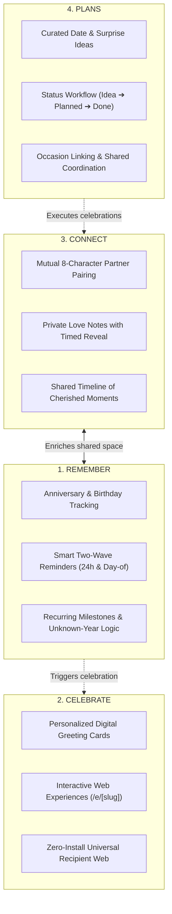
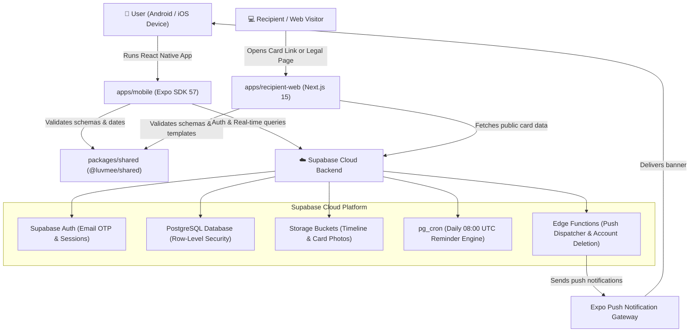

# LUVMEE — Master Product Handbook

**Document Version:** 1.0  
**Status:** **AUTHORITATIVE MASTER REFERENCE**  
**Last Updated:** October 16, 2026  
**Audience:** Founder, Leadership, Product Specialists, QA, and Engineering  

---

## Welcome to the LUVMEE Knowledge System

This handbook is the central command center and entry point for all product, technical, operational, and architectural documentation for **LUVMEE**. 

As founder, you can use this handbook to:
1. Explain LUVMEE simply to non-technical partners, investors, or advisors.
2. Understand exactly how every button, screen, database table, and background job works.
3. Verify what has been completed, what is in review, and what requires future attention.
4. Onboard any new engineer or technical contributor quickly without ambiguity.

---

## Master Documentation Suite Navigation

Every topic in the LUVMEE platform is thoroughly detailed across dedicated guides. Use this index to navigate directly to what you need:

```mermaid
flowchart TD
    A["📘 Master Product Handbook<br>(docs/LUVMEE_MASTER_PRODUCT_HANDBOOK.md)"] --> B["💡 Founder & Product Understanding"]
    A --> C["⚙️ Architecture & Data Systems"]
    A --> D["🚀 Operations, Quality & Releases"]

    B --> B1["LUVMEE_PLAIN_ENGLISH_GUIDE.md"]
    B --> B2["LUVMEE_FEATURE_BY_FEATURE_MANUAL.md"]
    B --> B3["LUVMEE_USER_JOURNEYS.md"]
    B --> B4["LUVMEE_GLOSSARY.md"]
    B --> B5["LUVMEE_FOUNDER_FAQ.md"]

    C --> C1["LUVMEE_SYSTEM_ARCHITECTURE.md"]
    C --> C2["LUVMEE_DATA_AND_PRIVACY_GUIDE.md"]
    C --> C3["LUVMEE_AUTHENTICATION_AND_ACCOUNT_GUIDE.md"]
    C --> C4["LUVMEE_NOTIFICATIONS_AND_REMINDERS.md"]
    C --> C5["LUVMEE_WEBSITE_AND_SHARING_GUIDE.md"]

    D --> D1["LUVMEE_DEPLOYMENT_AND_RELEASE_GUIDE.md"]
    D --> D2["LUVMEE_ADMIN_AND_OPERATIONS_GUIDE.md"]
    D --> D3["LUVMEE_TESTING_AND_QUALITY_REPORT.md"]
    D --> D4["LUVMEE_TROUBLESHOOTING_MANUAL.md"]
    D --> D5["LUVMEE_DEVELOPER_HANDOVER.md"]
    D --> D6["LUVMEE_KNOWN_LIMITATIONS_AND_NEXT_ACTIONS.md"]
    D --> D7["LUVMEE_ASSISTANT_KNOWLEDGE_BASE.md"]
    D --> D8["LUVMEE_SCREENSHOT_CATALOGUE.md"]
```

### Quick Links to All 18 Documents:
1. [Plain English Founder's Guide](file:///c:/Users/DANIEL/Documents/WebApp%20Projects/luvmee/docs/LUVMEE_PLAIN_ENGLISH_GUIDE.md) — Non-technical analogies, core concepts, and operational mental models.
2. [Feature-by-Feature Manual](file:///c:/Users/DANIEL/Documents/WebApp%20Projects/luvmee/docs/LUVMEE_FEATURE_BY_FEATURE_MANUAL.md) — Screen-by-screen, button-by-button manual for every feature.
3. [User Journeys](file:///c:/Users/DANIEL/Documents/WebApp%20Projects/luvmee/docs/LUVMEE_USER_JOURNEYS.md) — 12 step-by-step user paths from first install to account deletion.
4. [System Architecture](file:///c:/Users/DANIEL/Documents/WebApp%20Projects/luvmee/docs/LUVMEE_SYSTEM_ARCHITECTURE.md) — Technical diagrams, monorepo anatomy, and codebase file map.
5. [Data, Privacy & Security Guide](file:///c:/Users/DANIEL/Documents/WebApp%20Projects/luvmee/docs/LUVMEE_DATA_AND_PRIVACY_GUIDE.md) — Storage breakdown, RLS security policies, and privacy protocols.
6. [Authentication & Account Guide](file:///c:/Users/DANIEL/Documents/WebApp%20Projects/luvmee/docs/LUVMEE_AUTHENTICATION_AND_ACCOUNT_GUIDE.md) — OTP email, guest mode, session persistence, and deletion.
7. [Notifications & Reminders Guide](file:///c:/Users/DANIEL/Documents/WebApp%20Projects/luvmee/docs/LUVMEE_NOTIFICATIONS_AND_REMINDERS.md) — 24-hour and day-of reminders, pg_cron, and push pipelines.
8. [Website & Sharing Guide](file:///c:/Users/DANIEL/Documents/WebApp%20Projects/luvmee/docs/LUVMEE_WEBSITE_AND_SHARING_GUIDE.md) — Recipient web app, dynamic surprise cards, and legal portals.
9. [Admin & Operations Guide](file:///c:/Users/DANIEL/Documents/WebApp%20Projects/luvmee/docs/LUVMEE_ADMIN_AND_OPERATIONS_GUIDE.md) — Health checks, monitoring, failure recovery, and routine tasks.
10. [Testing & Quality Report](file:///c:/Users/DANIEL/Documents/WebApp%20Projects/luvmee/docs/LUVMEE_TESTING_AND_QUALITY_REPORT.md) — 52 passing unit tests, type verification, and build proof.
11. [Troubleshooting Manual](file:///c:/Users/DANIEL/Documents/WebApp%20Projects/luvmee/docs/LUVMEE_TROUBLESHOOTING_MANUAL.md) — Step-by-step resolution trees for common user and app issues.
12. [Deployment & Release Guide](file:///c:/Users/DANIEL/Documents/WebApp%20Projects/luvmee/docs/LUVMEE_DEPLOYMENT_AND_RELEASE_GUIDE.md) — EAS Build, Vercel deployments, and Google Play Console release.
13. [Developer Handover](file:///c:/Users/DANIEL/Documents/WebApp%20Projects/luvmee/docs/LUVMEE_DEVELOPER_HANDOVER.md) — Complete setup instructions, constraints, and conventions for new coders.
14. [Screenshot Catalogue](file:///c:/Users/DANIEL/Documents/WebApp%20Projects/luvmee/docs/LUVMEE_SCREENSHOT_CATALOGUE.md) — Verified visual catalog of mobile screens and web experiences.
15. [Glossary](file:///c:/Users/DANIEL/Documents/WebApp%20Projects/luvmee/docs/LUVMEE_GLOSSARY.md) — Alphabetical definitions of all technical and product terms.
16. [Founder FAQ](file:///c:/Users/DANIEL/Documents/WebApp%20Projects/luvmee/docs/LUVMEE_FOUNDER_FAQ.md) — Direct, grounded answers to 25+ essential founder/investor questions.
17. [Known Limitations & Next Actions](file:///c:/Users/DANIEL/Documents/WebApp%20Projects/luvmee/docs/LUVMEE_KNOWN_LIMITATIONS_AND_NEXT_ACTIONS.md) — Verified boundaries, operational checklist, and next priorities.
18. [Assistant Knowledge Base](file:///c:/Users/DANIEL/Documents/WebApp%20Projects/luvmee/docs/LUVMEE_ASSISTANT_KNOWLEDGE_BASE.md) — AI and human support knowledge base with 30+ grounded Q&As.

---

## 1. What LUVMEE Is

### Brand Positioning
> **LUVMEE — “A little help remembering. A better way to show you care.”**

LUVMEE is a mobile-first couples and relationship platform designed to remove the friction, anxiety, and forgetfulness that often burdens romantic partnerships. 

Modern life is busy. Anniversaries get overlooked, birthdays arrive with zero preparation, thoughtful sentiments get lost in crowded chat apps alongside grocery lists and work pings, and planning meaningful dates gets postponed.

LUVMEE creates a dedicated, private, and intimate digital haven exclusively for two people. It combines:
1. An intelligent relationship calendar that guarantees important dates are never missed.
2. A private Love Notes channel with surprise reveals and scheduled delivery.
3. A shared Memory Timeline to record milestones and cherished photos.
4. A public web card generator that lets partners create rich, interactive digital cards accessible on any device without requiring the recipient to download an app.

---

## 2. The Four Pillars of LUVMEE

LUVMEE’s product architecture is organized around four synergistic pillars:

### Pillar 1: Remember
- **Purpose:** Make it effortless to capture, organize, and remember every significant relationship milestone.
- **Capabilities:**
  - Tracks relationship start dates, birthdays, anniversaries, and custom milestones.
  - Automatically calculates days together ("Together 412 days").
  - Two-wave reminder engine: sends automated notifications 24 hours in advance and the morning of the event.
  - Gracefully handles unknown birth years (preserving month/day reminders without miscalculating age).

### Pillar 2: Celebrate
- **Purpose:** Provide a thoughtful, modern way to express love through personalized digital experiences.
- **Capabilities:**
  - Digital greeting cards with customizable romantic themes, emojis, personalized messages, and secret codes.
  - Unique web links hosted on `https://luvmee.eventsslot.com/e/[slug]` that open interactive cards on phones, tablets, or computers.
  - Recipients do not need an account or app installation to open and enjoy their card.

### Pillar 3: Connect
- **Purpose:** Create an exclusive, secure, and intimate bridge between two partners.
- **Capabilities:**
  - One-to-one partner pairing using private 8-character invite codes (e.g., `LUV-VED9`).
  - Private Love Notes composer with delivery dates and customizable "open" locks (e.g., "Opens on your anniversary").
  - Shared Memory Timeline where both partners contribute memories and milestone photos.

### Pillar 4: Plans
- **Purpose:** Transform thoughtful intentions into scheduled, real-world romantic moments.
- **Capabilities:**
  - Capture date night ideas, restaurant wishlists, travel dreams, and gift concepts.
  - Organize plans by status (`Idea`, `Planned`, `Completed`).
  - Associate specific plans with upcoming calendar occasions.

---

## 3. How the Platform Fits Together

LUVMEE consists of four primary software components operating in harmony:

### Component Summary:
1. **Mobile Application (`apps/mobile`):**  
   Built with **React Native 0.86** and **Expo SDK 57** using Expo Router. This is the primary daily app used by partners on their Android or iOS devices.
2. **Recipient Web Application (`apps/recipient-web`):**  
   Built with **Next.js 15.1.0** (React 19, Tailwind CSS). Deployed live on Vercel at `https://luvmee.eventsslot.com`. It hosts the public card viewer (`/e/[slug]`), the legal privacy policy (`/privacy`), the terms of service (`/terms`), the help center (`/support`), and the public account deletion portal (`/delete-account`).
3. **Shared Business Logic (`packages/shared`):**  
   TypeScript package containing data validation schemas (Zod), date calculation math, reminder algorithms, and template models used by both mobile and web to ensure 100% consistency.
4. **Cloud Backend (`supabase/`):**  
   Hosted on Supabase (`https://zfcqbydqdmoyjgiebplo.supabase.co`). Houses PostgreSQL tables, Row-Level Security (RLS) data protection policies, pg_cron background jobs, and edge functions.

---

## 4. Complete Feature Inventory Table

Below is the verified inventory of every major feature currently in the LUVMEE codebase:

| Feature Name | Primary Purpose | Who Uses It | Location in App | Main User Action | Implementation Status | Evidence / Test |
| :--- | :--- | :--- | :--- | :--- | :---: | :--- |
| **Email OTP Authentication** | Passwordless sign-in via 6-digit email code | All users | Auth Modal / Screen | Enter email ➔ Enter 6-digit OTP | **Verified Working** | Supabase Auth API, OTP callback logic tested |
| **Guest Mode** | Explore app features without signing in | New visitors | Auth Gate | Click "Continue as Guest" | **Verified Working** | Local AsyncStorage state, auth bypass guard |
| **Relationship Dashboard** | View live relationship day counter and next event | Paired/Solo users | Home Tab (`/index`) | View counter & quick actions | **Verified Working** | `apps/mobile/app/(tabs)/index.tsx`, date difference engine |
| **Partner Pairing** | Link two accounts into an exclusive pair | Couples | Profile / Connect Modal | Share 8-char code or enter partner's code | **Verified Working** | `PartnerConnectModal.tsx`, RPC `connect_partners` |
| **Occasion Calendar** | Schedule birthdays, anniversaries, and milestones | All users | Calendar Tab (`/calendar`) | Tap date ➔ Add occasion ➔ Set reminder | **Verified Working** | `calendar.tsx`, `packages/shared/src/utils/calendar.ts` |
| **Automated Reminders** | Receive 24-hour and day-of push notifications | All users | Background system | Triggered by scheduled cron | **Verified Working** | `pg_cron` at 08:00 UTC, unit tests in `scheduled-reminders.test.mjs` |
| **Love Notes** | Send private notes with customizable reveal dates | Paired users | Messages Tab (`/messages`) | Compose note ➔ Set open date ➔ Send | **Verified Working** | `messages.tsx`, RLS isolation, surprise unlock logic |
| **Memory Timeline** | Store shared milestones and photos in order | Paired users | Memories Tab (`/memories`) | Add memory ➔ Upload photo ➔ Set date | **Verified Working** | `memories.tsx`, Supabase Storage bucket integration |
| **Date & Surprise Plans** | Brainstorm and track date night ideas | All users | Plans Screen | Create plan ➔ Toggle status (Idea/Done) | **Verified Working** | `plans.tsx`, status filter tabs |
| **Recipient Web Cards** | View interactive cards without an app | Any recipient | Web URL (`/e/[slug]`) | Open link in any web browser | **Verified Working** | Next.js dynamic App Router at `apps/recipient-web/app/e/[slug]` |
| **Legal & Privacy Pages** | Public policies for Google Play compliance | Public / Reviewers | Web (`/privacy`, `/terms`) | Navigate in browser or in-app | **Verified Working** | HTTP 200 verified on `https://luvmee.eventsslot.com/privacy` |
| **Account Deletion** | Permanently erase user data and account | Any user | Profile & Web (`/delete-account`) | Click delete ➔ Confirm deletion | **Verified Working** | Self-service web form & Edge function `delete-user-account` |

---

## 5. Current Release State (October 2026)

LUVMEE Version 1.0 has reached **official release closure** and has been submitted to Google Play:

- **Google Play Submission:** **IN REVIEW** (Submitted October 15, 2026).
- **Target Android Version:** Android 15 & 16 (API 35/36 compliant).
- **Production Artifact:** Android App Bundle (`.aab`) signed and verified on EAS.
- **Web Status:** 100% active on Vercel at `https://luvmee.eventsslot.com`.
- **Next Milestone:** Upon Google review approval, initiate the **14-day Closed Test with 12+ testers** before enabling public global production rollout.
