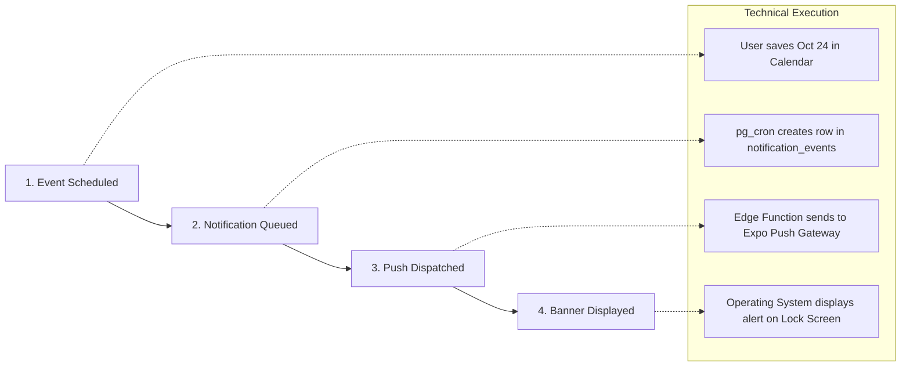
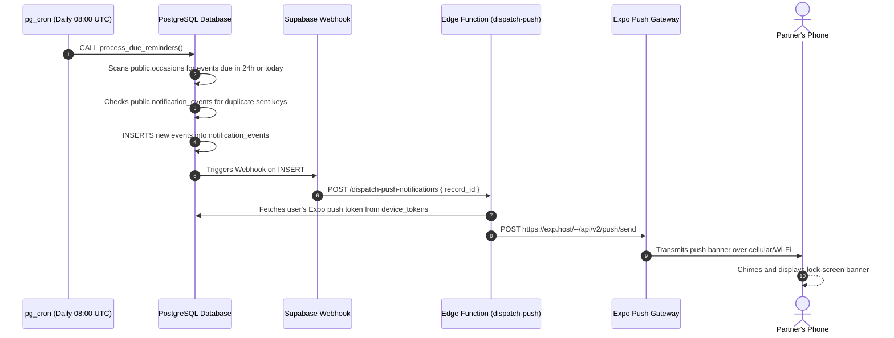

# LUVMEE — Notifications & Reminders Engine Guide

**Document Version:** 1.0  
**Target Audience:** Founder, Engineers, QA Testers, and Product Team  
**Last Updated:** October 16, 2026  

---

## 1. Executive Summary & The Core Promise

The core value proposition of LUVMEE is:
> **“A little help remembering. A better way to show you care.”**

If a reminder fails, an anniversary is forgotten, leading to real-world relationship disappointment. To make LUVMEE's reminder system resilient and reliable, the architecture uses a **Dual-Engine Strategy**:

1. **Cloud Automated Engine (Primary):** An autonomous server cron job (`pg_cron`) that wakes up every morning in the cloud, evaluates all upcoming relationship events, and dispatches push notifications to physical devices.
2. **In-App Resilient Fallback (Secondary):** A local evaluation engine that runs whenever a user opens the mobile app, verifying that no reminders were missed even if the cloud server experienced downtime or the user was on airplane mode.

---

## 2. The Four Stages of a Reminder

It is critical to distinguish between the four stages of a reminder's lifecycle:



| Stage | What Happens | Where It Happens | Can It Fail Here? |
| :--- | :--- | :--- | :--- |
| **1. Scheduled** | Date and reminder preferences saved | `public.occasions` table | No, protected by Zod schema validation |
| **2. Queued** | Database evaluates date and creates event row | `public.notification_events` | Only if `pg_cron` extension is disabled |
| **3. Dispatched** | Edge function sends payload to Expo Push API | Supabase Edge Function | Only if network or service outage occurs |
| **4. Displayed** | Phone chimes and shows banner on lock screen | Android / iOS OS | Fails if user disabled phone notifications |

---

## 3. How Reminder Dates Are Calculated

The date arithmetic engine lives in `@luvmee/shared/src/utils/calendar.ts` and is covered by automated unit tests.

### A. The Two-Wave Alert Strategy
For every major occasion, LUVMEE supports two distinct reminder alerts:
1. **The 24-Hour Heads-Up (The Preparation Wave):**  
   Fires 1 day before the event. Purpose: Give the partner time to buy flowers, write a note, make a dinner reservation, or prepare a surprise.  
   *Sample copy: "Tomorrow is Sarah's Birthday! 🎂 Have you prepared your surprise?"*
2. **The Day-Of Morning Chime (The Celebration Wave):**  
   Fires at 08:00 AM on the day of the event. Purpose: Ensure the first words the partner shares that morning are celebratory.  
   *Sample copy: "Today is your 3rd Wedding Anniversary! 💕 Celebrate your special day."*

### B. Recurring Events & Leap Years
- Most anniversaries and birthdays repeat every year. When an occasion is marked `is_recurring: true`, the engine automatically rolls the target year forward:
  - If today is November 1, 2026, and an anniversary was on October 24, 2026, the next reminder is calculated for **October 24, 2027**.
- **Leap Year Rule (February 29):** If an anniversary or birthday occurred on February 29th, during non-leap years the reminder automatically triggers on **February 28th**, ensuring the milestone is never skipped.

### C. Unknown Year Handling
- Many people remember a partner or friend's birthday month and day (e.g., May 14th) but cannot remember whether they were born in 1994, 1995, or 1996.
- If a user checks *"Year Unknown"*, LUVMEE sets a database flag `year_unknown: true`.
- The reminder engine safely computes the next May 14th without attempting to display inaccurate ages (e.g., avoiding *"Sarah is 2,026 years old today"*).

---

## 4. Cloud Architecture: The Daily Alarm Clock (pg_cron)



### Technical Execution Details:
1. **Daily Cron Schedule:** Scheduled via PostgreSQL `pg_cron` with the expression `0 8 * * *` (8:00 AM UTC every day).
2. **Database Stored Procedure:** Invokes `process_due_reminders()`. This SQL function runs directly inside the database, bypassing external network latency.
3. **Database Webhook Trigger:** As soon as an event row is inserted into `public.notification_events`, a Supabase database webhook fires an asynchronous HTTP POST to the edge function.
4. **Edge Function (`supabase/functions/dispatch-push-notifications`):** Written in TypeScript on the Deno runtime. It gathers the device push token, formats the notification payload, and delivers it to Expo's push servers.

---

## 5. Duplicate Prevention & Offline Resilience

A major fear in reminder software is spamming users with duplicate alerts or failing when the phone is in airplane mode. LUVMEE solves both:

### A. How Duplicate Alerts Are Prevented
Every notification generated by the database creates a unique composite deduplication key:
```text
dedup_key = "user_id" + "occasion_id" + "reminder_type" + "target_date"
```
For example: `usr_123_occ_456_24h_2026-10-24`.
Before inserting a reminder, the database queries whether an event with this exact `dedup_key` already exists for this calendar year. If found, the insertion is rejected. This guarantees a user will never receive two identical anniversary reminders.

### B. In-App Fallback Engine (`notificationService.ts`)
What if the cloud server experienced a brief network blip at 08:00 UTC?
- Every time the user opens the mobile app, `notificationService.ts` executes an in-app check: `processDueReminders()`.
- **Concurrency Locking:** To prevent the phone from colliding with the cloud, the in-app service maintains a **5-minute cooldown throttle** stored in `AsyncStorage`.
- If an alert is due and has not been acknowledged, the app surfaces an elegant in-app reminder card directly at the top of the Home dashboard.

---

## 6. User Notification Controls

Users have complete control over their reminder preferences:
- **Global Permission:** When first installing LUVMEE, the app requests OS notification permission. If denied, reminders are displayed in-app only.
- **Per-Occasion Toggles:** Inside the Occasion Creator / Editor:
  - Toggle 1: *"Remind me 24 hours before"* (Default: On)
  - Toggle 2: *"Remind me on the day at 8:00 AM"* (Default: On)
- **Partner Sync:** If an occasion is marked as shared, both partners receive the reminder on their respective devices.
