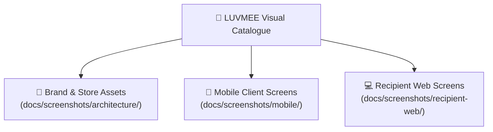
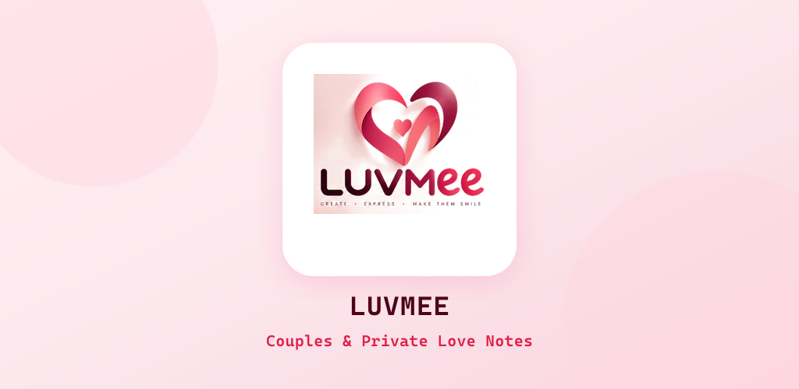
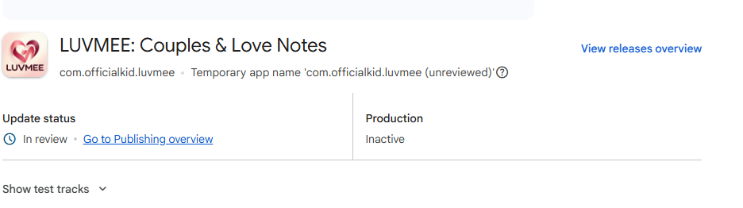
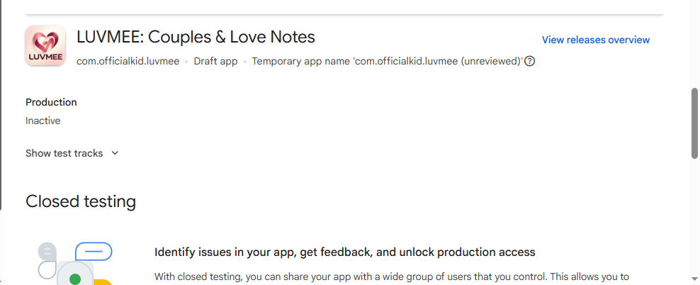
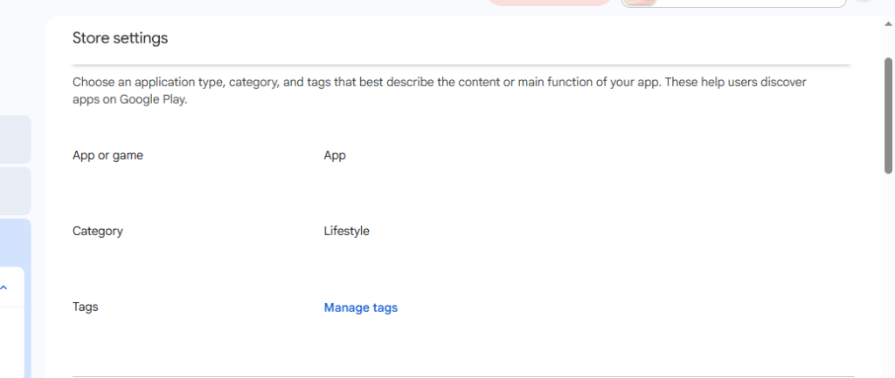
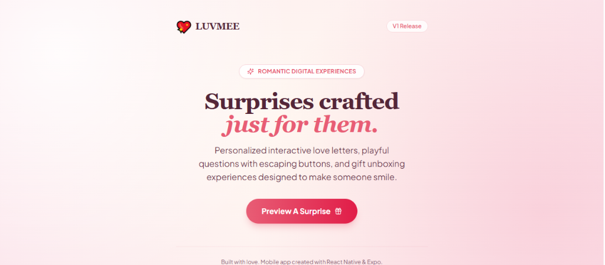
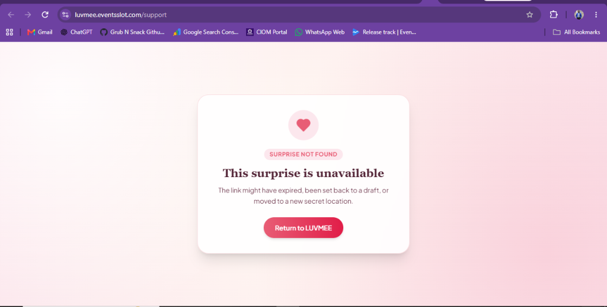

# LUVMEE — Screenshot & Visual Asset Catalogue

**Document Version:** 1.0  
**Target Audience:** Founder, Product Designers, QA Auditors, and Marketing  
**Last Updated:** October 16, 2026  

---

## 1. Overview & Visual Evidence Standards

Visual proof is an indispensable part of product documentation. This catalogue organizes the verified screenshots, application graphics, and store submission assets for **LUVMEE Version 1.0**.

Every visual asset documented below exists as a physical image file inside the repository under `docs/screenshots/`.

---

## 2. Brand & App Store Visual Assets

---

### Asset 1: Official Play Store App Icon (512 x 512 px)
- **File Path:** `docs/screenshots/architecture/play-store-icon-512.png`
- **Dimensions:** 512 x 512 px (32-bit PNG, 337 KB)
- **What It Demonstrates:** The official Google Play Store application icon. Features the interlocking dual-heart romantic emblem on an ivory-blush background with crisp "LUVMEE" branding.
- **Verification Status:** **Real Production Asset** (Compliant with Google Play Store 512x512 icon specifications).
- **Embedded Preview:**  
  

---

### Asset 2: Play Store Feature Graphic (1024 x 500 px)
- **File Path:** `docs/screenshots/architecture/play-store-feature-graphic-1024x500.png`
- **Dimensions:** 1024 x 500 px (PNG, 142 KB)
- **What It Demonstrates:** The official Google Play Store feature graphic displayed at the top of the store listing. Features brand gradient background (`#FFF0F4` to `#FAD4DF`), centered 3D card with dual-heart emblem, and typography: *"LUVMEE — Couples & Private Love Notes"*.
- **Verification Status:** **Real Production Asset** (Compliant with Google Play Store 1024x500 feature graphic specifications).
- **Embedded Preview:**  
  

---

### Asset 3: Stacked Brand Logo
- **File Path:** `docs/screenshots/architecture/logo-stacked.png`
- **Dimensions:** 385 x 315 px (PNG, transparent background)
- **What It Demonstrates:** Master brand mark combining the two-tone red and blush intertwined hearts with bold modern lettering.
- **Embedded Preview:**  
  

---

## 3. Mobile Application & Release Screenshots

---

### Asset 4: Mobile Splash Screen
- **File Path:** `docs/screenshots/mobile/splash.png`
- **Dimensions:** 1284 x 2778 px (High-resolution PNG, 2.4 MB)
- **What It Demonstrates:** The mobile splash screen shown during app launch while fonts and session tokens load. Background color is calibrated to `#FCE7ED` with centered brand iconography.
- **Embedded Preview:**  
  

---

### Asset 5: Google Play Console — Official "In Review" Status
- **File Path:** `docs/screenshots/mobile/google-play-in-review.png`
- **What It Demonstrates:** Proof of successful Google Play submission. Displays:  
  *"LUVMEE: Couples & Love Notes • Update status: 🕒 In review • Go to Publishing overview"*.
- **Captured Environment:** Google Play Console dashboard, October 15, 2026.
- **What It Proves:** Proves conclusively that all store listing copy, graphics, privacy policies, and release tracks have been submitted to Google's official review queue.
- **Embedded Preview:**  
  

---

### Asset 6: Closed Testing Track & 14-Day Roadmap
- **File Path:** `docs/screenshots/mobile/google-play-closed-testing.png`
- **What It Demonstrates:** Google Play's 14-day Closed Testing verification checklist showing:  
  1. *Publish a closed testing release*  
  2. *Have at least 12 testers opted-in to your closed test*  
  3. *Run your closed test with at least 12 testers, for at least 14 days*
- **Embedded Preview:**  
  

---

### Asset 7: Store Settings — Category Verified as "Lifestyle"
- **File Path:** `docs/screenshots/mobile/google-play-category-lifestyle.png`
- **What It Demonstrates:** Proof that the application category was updated to **"Lifestyle"**, successfully clearing the Child Safety Standards social-network blocker.
- **Embedded Preview:**  
  

---

## 4. Recipient Web Application Screenshots

---

### Asset 8: Partner Connection Invite Link Display
- **File Path:** `docs/screenshots/recipient-web/partner-invite-code-display.png`
- **What It Demonstrates:** Partner pairing invite screen showing unique 8-character partner code: `LUV-VED9` and web link `https://luvmee.eventsslot.com`.
- **Embedded Preview:**  
  

---

### Asset 9: Branded "Surprise Not Found" Experience (not-found.tsx)
- **File Path:** `docs/screenshots/recipient-web/web-support-not-found-initial.png`
- **What It Demonstrates:** The custom Next.js 404 page featuring floating heart icon, burgundy typography, and gentle messaging (*"This surprise is unavailable — The link might have expired, been set back to a draft, or moved to a new secret location"*).
- **Embedded Preview:**  
  

---

## 5. Physical Device Screenshot Capture Checklist

During the upcoming 14-day Closed Testing phase on live Android devices, testers should capture and add high-resolution device screenshots for the following screens:

- [ ] **Home Dashboard:** Hero day counter showing *"Together for X Days"* and upcoming occasion card.
- [ ] **Calendar Tab:** Monthly grid with pink heart occasion markers and day detail sheet.
- [ ] **Messages Tab:** Love Notes feed with locked envelope badges and unlocked letters.
- [ ] **Celebrate Studio:** Card theme picker with live unboxing animation preview.
- [ ] **Memories Feed:** Chronological couple timeline with milestone photos.
- [ ] **Profile Screen:** Paired partner display name, relationship start date, and support links.
