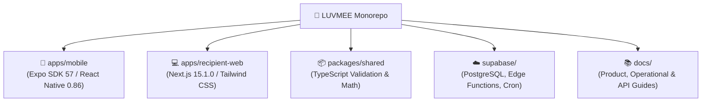
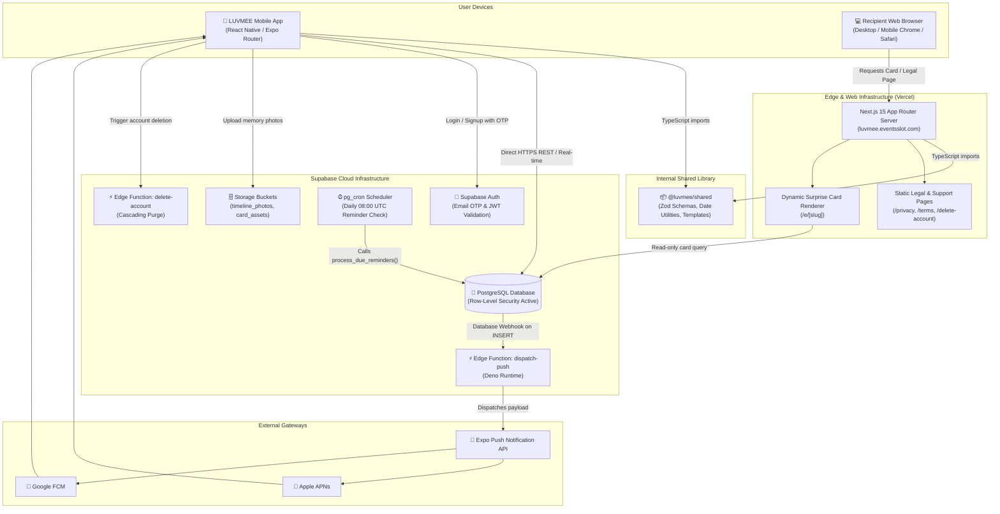
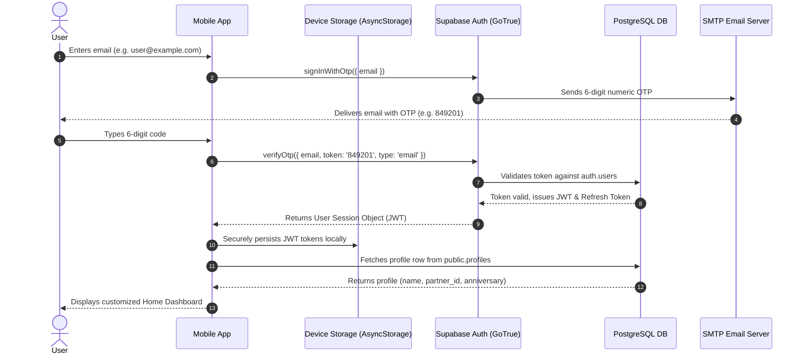
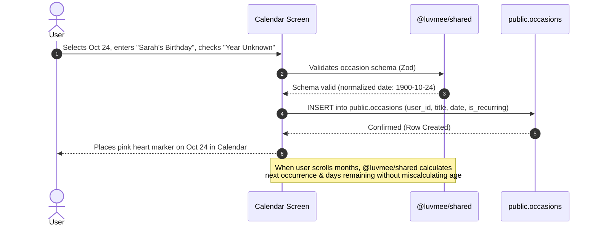
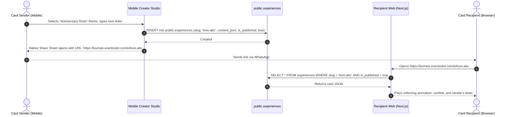
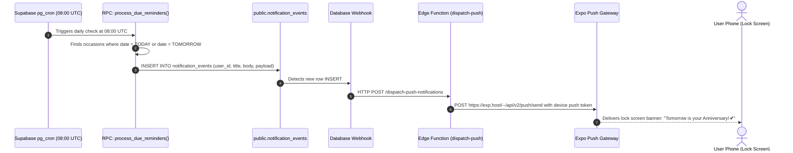
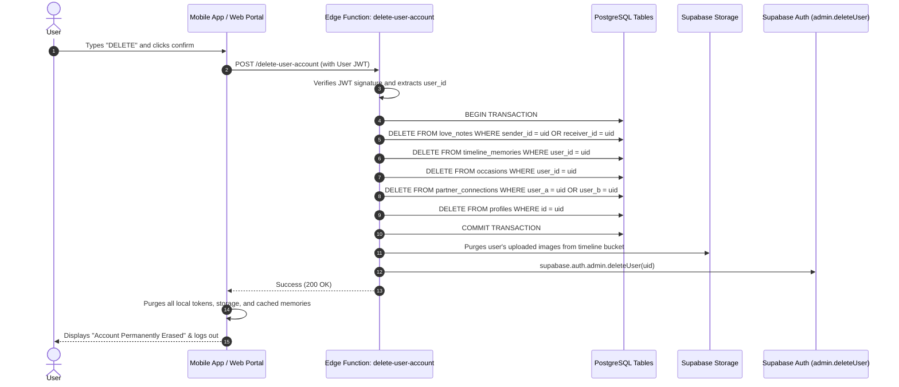

# LUVMEE — System Architecture & Codebase Map

**Document Version:** 1.0  
**Target Audience:** Founder, Lead Architects, Senior Engineers, and Technical Onboarding  
**Last Updated:** October 16, 2026  

---

## 1. Architectural Philosophy & Technology Stack

LUVMEE is architected as a **modern, modular monorepo** designed for speed, security, and low operational overhead. 

Rather than maintaining separate fragmented repositories for the mobile app, web app, and shared logic, the entire codebase lives in a unified repository managed by npm workspaces.

### Technology Matrix

| Layer | Technology | Version | Key Responsibility |
| :--- | :--- | :--- | :--- |
| **Mobile Client** | React Native / Expo | Expo SDK 57 / RN 0.86 | Native iOS & Android couples app with offline caching |
| **Mobile Routing** | Expo Router | Modern file-based | Declarative tab-based navigation with deep linking (`luvmee://`) |
| **Web Client** | Next.js App Router | 15.1.0 (React 19) | Zero-install recipient cards, legal pages, and deletion portal |
| **Styling** | Tailwind CSS / StyleSheet | 3.4.1 | Unified romantic design system (`#FCE7ED`, `#E11D48`, `#4C0519`) |
| **Shared Core** | TypeScript / Zod | 5.3.3 | Data validation schemas, anniversary math, and card models |
| **Database** | PostgreSQL | 15.x (Supabase) | Relational storage with strict Row-Level Security (RLS) |
| **Authentication** | Supabase Auth | GoTrue Engine | Passwordless 6-digit Email OTP & JWT session tokens |
| **File Storage** | Supabase Storage | S3-compatible | Storage for memory photos and card visual assets |
| **Scheduled Tasks** | PostgreSQL pg_cron | v1.4 | Automated daily 08:00 UTC anniversary reminder evaluation |
| **Edge Compute** | Deno / Supabase Functions | v1.x | Push notification dispatcher & cascading account deletion |
| **Push Gateway** | Expo Push Notification API | v2 API | Cross-platform push delivery to Apple APNs and Android FCM |
| **Cloud Hosting** | Vercel & Supabase Cloud | Production | 24/7 high-availability hosted infrastructure |

---

## 2. Six Core Architecture Diagrams

---

### Diagram 1: Overall Platform Architecture

#### Plain-English Explanation:
The mobile app and the website are two windows into the same central cloud brain (Supabase). The mobile app allows couples to create memories, send love notes, and schedule occasions. The website allows anyone with a link to view a digital card without needing an app. In the background, automated clockwork checks for upcoming anniversaries and dispatches push banners to user phones.

---

### Diagram 2: Authentication & Session Persistence Flow

#### Plain-English Explanation:
When a user signs in, they never type a password. They receive a 6-digit code in their email. When entered, Supabase issues an encrypted electronic passport (a JWT token) that the phone saves securely. Every time the app makes a request to fetch notes or anniversaries, it presents this passport so the database knows exactly who is asking.

---

### Diagram 3: Saving and Retrieving Important Dates

#### Plain-English Explanation:
When an anniversary or birthday is added, the app first checks that the date is valid using shared rules. If the user doesn't know the birth year, the system stores a special placeholder so it can still sound the alarm every October 24th without accidentally telling you that your friend is 2,000 years old!

---

### Diagram 4: Creating and Opening a Shared Card

#### Plain-English Explanation:
A user designs a greeting card in the mobile app. The app saves the design in the database and generates a short, unique web link. When the partner clicks that link in WhatsApp, our web server immediately fetches the design and plays a beautiful animated card on their screen without requiring any login.

---

### Diagram 5: Automated Reminder Generation & Delivery

#### Plain-English Explanation:
Every morning at 8:00 AM UTC, an automatic alarm clock inside the database wakes up, looks through all couples' calendars, and finds who has a birthday or anniversary coming up in the next 24 hours. It automatically generates a push notification and delivers it straight to the user's phone lock screen.

---

### Diagram 6: Permanent Account Deletion Lifecycle

#### Plain-English Explanation:
When a user asks to delete their account, we don't just hide their profile. An authorized cloud worker systematically scrubs their love notes, photos, calendar events, partner links, and login records across every table, deletes their image files, cancels their login passport, and purges all local storage on the phone.

---

## 3. Codebase File Map & Navigation Guide

This section is an authoritative directory of important files across the monorepo:

### Mobile Application (`apps/mobile`)
| File / Directory Path | Architectural Responsibility | Key Dependencies | When to Modify |
| :--- | :--- | :--- | :--- |
| `app/_layout.tsx` | Root application layout, font loading, theme provider, and global error boundaries | Expo Router, `@luvmee/shared` | When adding global providers, notification listeners, or app-wide styles |
| `app/(tabs)/_layout.tsx` | Bottom tab navigation bar configuring Home, Calendar, Celebrate, Messages, Profile | Expo Router, Lucide Icons | When adding/removing bottom navigation tabs |
| `app/(tabs)/index.tsx` | Home relationship dashboard featuring live day counter and upcoming alerts | `authService.ts`, `@luvmee/shared` | When updating home widgets, day counter presentation, or quick actions |
| `app/(tabs)/calendar.tsx` | Monthly calendar grid, date selection, and occasion cards | `@luvmee/shared`, `calendar.ts` | When modifying occasion scheduling, date pickers, or recurring logic |
| `app/(tabs)/messages.tsx` | Private Love Notes composer and timeline with reveal lock controls | Supabase Client, RLS | When enhancing note formatting, moods, or timed reveal animations |
| `app/(tabs)/profile.tsx` | Profile screen, partner pairing status, legal links, sign-out, deletion | WebBrowser, `authService.ts` | When updating user settings, partner status displays, or support links |
| `components/PartnerConnectModal.tsx` | Modal handling 8-character invite code display, sharing, and partner connection | Supabase RPC `connect_partners` | When modifying the partner pairing user flow or invite text |
| `services/authService.ts` | Handles OTP login, guest mode state, session persistence, and logout | `@supabase/supabase-js`, AsyncStorage | When altering authentication mechanisms or token persistence |
| `services/notificationService.ts` | In-app reminder evaluation and fallback synchronization | `@luvmee/shared`, AsyncStorage | When updating local notification scheduling or reminder cooldowns |
| `app.json` | Expo configuration: app name, bundle ID, version (`1.0.0`), `versionCode: 2` | Expo CLI, EAS Build | When updating app store versions, permissions, or splash configurations |
| `eas.json` | EAS Build profiles (`development`, `preview` APK, `production` AAB) | EAS CLI | When changing build outputs, keystore profiles, or cloud env variables |

### Recipient Web Application (`apps/recipient-web`)
| File / Directory Path | Architectural Responsibility | Key Dependencies | When to Modify |
| :--- | :--- | :--- | :--- |
| `app/layout.tsx` | Root HTML shell, fonts, metadata, and viewport configuration | Next.js App Router | When modifying SEO tags, root layouts, or global CSS imports |
| `app/page.tsx` | Public landing page introducing LUVMEE with direct app download links | `LegalNav.tsx`, `LegalFooter.tsx` | When updating homepage copy, marketing graphics, or store badges |
| `app/e/[slug]/page.tsx` | Dynamic server-rendered recipient card viewer | Supabase Client, `@luvmee/shared` | When enhancing digital greeting card animations or recipient features |
| `app/privacy/page.tsx` | Official Google Play compliant Privacy Policy | `LegalNav.tsx`, `LegalFooter.tsx` | When updating legal privacy disclosures or collected data categories |
| `app/terms/page.tsx` | Official Terms of Service for relationship messaging | `LegalNav.tsx`, `LegalFooter.tsx` | When updating terms of use, age limits, or dispute clauses |
| `app/support/page.tsx` | Help & Support portal with feature guides and support contact form | `LegalNav.tsx`, `LegalFooter.tsx` | When adding new help guides, FAQs, or updating customer service emails |
| `app/delete-account/page.tsx` | Public self-service account deletion portal required by Google Play | `DeleteAccountForm.tsx` | When modifying public account deletion flows or verification emails |

### Shared Business Logic (`packages/shared`)
| File / Directory Path | Architectural Responsibility | Key Dependencies | When to Modify |
| :--- | :--- | :--- | :--- |
| `src/schemas/` | Zod validation schemas for occasions, profiles, love notes, cards | Zod | When adding or altering data models to ensure mobile/web parity |
| `src/utils/calendar.ts` | Date arithmetic, leap year calculations, unknown-year logic, day deltas | Pure TypeScript | When modifying anniversary math or reminder date calculations |
| `src/templates/` | Pre-designed greeting card themes, color palettes, and animation configs | Pure TypeScript | When introducing new card templates or visual themes |
