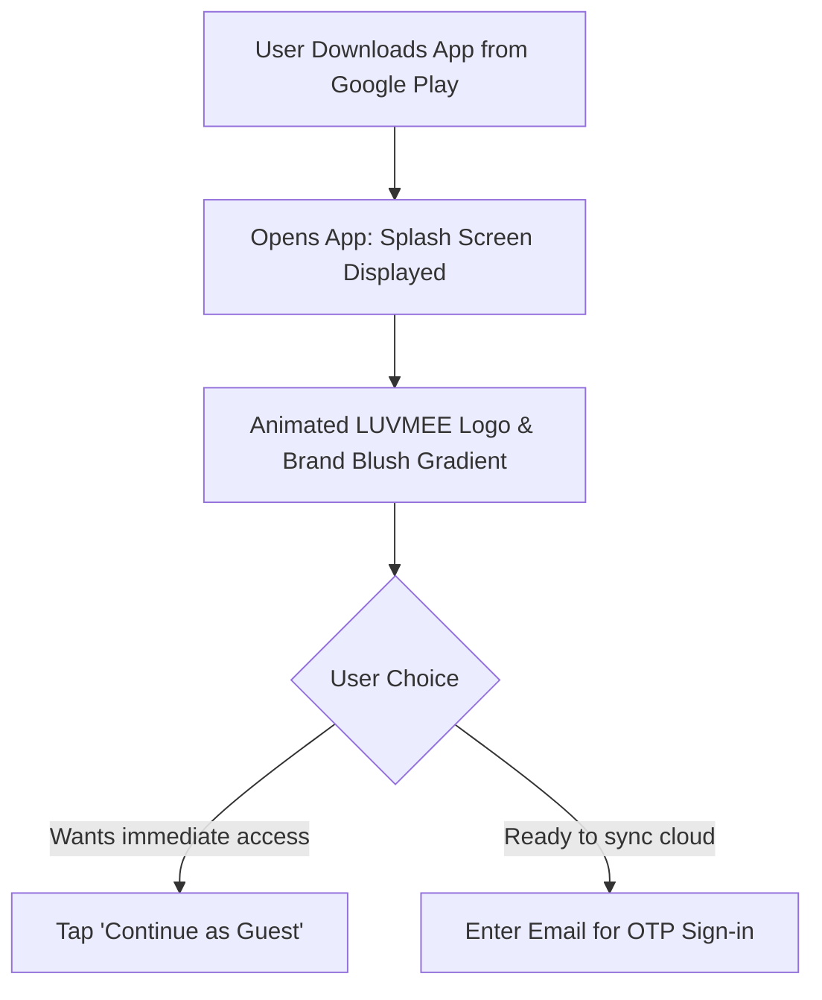
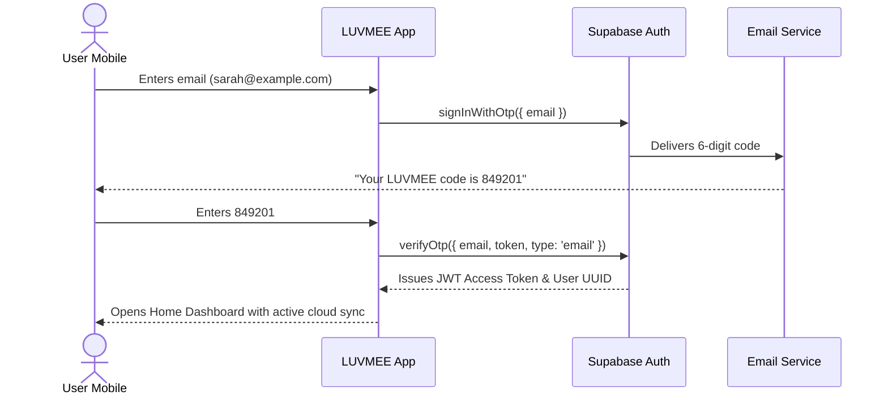
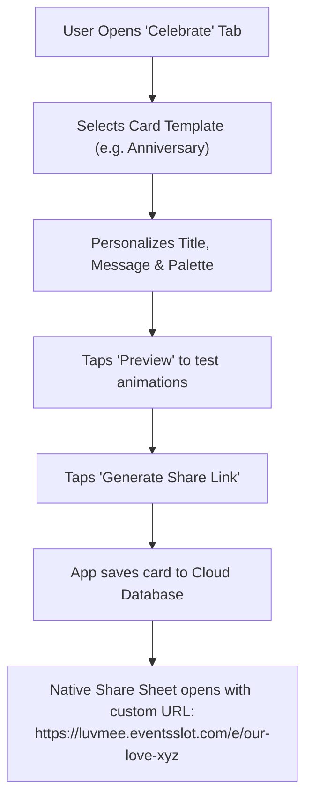
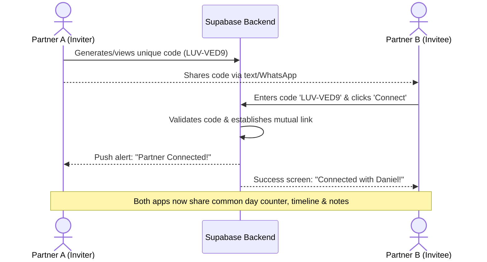

# LUVMEE — Comprehensive User Journeys

**Document Version:** 1.0  
**Target Audience:** Founder, Product Designers, QA Engineers, and Support Specialists  
**Last Updated:** October 16, 2026  

---

## Overview

A "User Journey" describes the exact sequence of thoughts, actions, screens, and system events that occur when a person interacts with LUVMEE. 

Documenting user journeys ensures that everyone on the team understands:
1. What the user actually experiences at every click.
2. What happens behind the scenes in the database, API, and cloud services.
3. How failure cases and errors are handled gracefully.

This document details the **12 core user journeys** supported by the LUVMEE platform today.

---

## Master Journey Index

1. [Journey 1: Discovery & First App Launch](#journey-1-discovery--first-app-launch)
2. [Journey 2: Exploring as a Guest (No Account Required)](#journey-2-exploring-as-a-guest-no-account-required)
3. [Journey 3: Creating an Account via Email OTP](#journey-3-creating-an-account-via-email-otp)
4. [Journey 4: Saving an Important Occasion & Reminder](#journey-4-saving-an-important-occasion--reminder)
5. [Journey 5: Designing and Sharing a Digital Greeting Card](#journey-5-designing-and-sharing-a-digital-greeting-card)
6. [Journey 6: Recipient Opening a Shared Card Link on Web](#journey-6-recipient-opening-a-shared-card-link-on-web)
7. [Journey 7: Connecting with a Partner via Invite Code](#journey-7-connecting-with-a-partner-via-invite-code)
8. [Journey 8: Sending a Private Love Note with Timed Reveal](#journey-8-sending-a-private-love-note-with-timed-reveal)
9. [Journey 9: Adding and Updating a Romantic Date Plan](#journey-9-adding-and-updating-a-romantic-date-plan)
10. [Journey 10: Receiving an Automated Anniversary Reminder](#journey-10-receiving-an-automated-anniversary-reminder)
11. [Journey 11: Signing Out & Clearing Cached State](#journey-11-signing-out--clearing-cached-state)
12. [Journey 12: Requesting Permanent Account & Data Deletion](#journey-12-requesting-permanent-account--data-deletion)

---

## Journey 1: Discovery & First App Launch

- **Starting Point:** User installs LUVMEE from Google Play and taps the icon.
- **Preconditions:** Android device running Android 8.0+ or iOS device running iOS 14+.
- **Step-by-Step Experience:**
  1. Splash screen displays centered LUVMEE stacked logo with subtle pulse animation on a brand blush background (`#FCE7ED`).
  2. Welcome screen appears presenting brand positioning: *"A little help remembering. A better way to show you care."*
  3. User is presented with two clear options: **"Sign In with Email"** or **"Continue as Guest"**.
- **Data Operations:** Checks device storage (`AsyncStorage`) for existing auth tokens. Finding none, renders auth onboarding gate.
- **Services Involved:** Local React Native runtime, Expo Router.
- **Error Paths:** If device storage is corrupted, gracefully resets local state to unauthenticated default.
- **Verification Status:** **Verified Working**.

---

## Journey 2: Exploring as a Guest (No Account Required)

- **Starting Point:** Onboarding screen.
- **Preconditions:** User does not want to provide personal information yet.
- **Step-by-Step Experience:**
  1. User taps **"Continue as Guest"**.
  2. App immediately navigates to the **Home** dashboard.
  3. Pre-loaded sample relationship widgets appear (e.g. sample anniversary counter and sample date plan).
  4. User can browse the Calendar, test the Greeting Card studio, and create local date plans.
  5. Tapping "Connect Partner" opens a friendly modal: *"Create an account to invite your partner and sync in real time."*
- **Data Operations:** Writes `@luvmee:guest_mode = true` to `AsyncStorage`. Zero database calls.
- **Privacy Implications:** 100% private to the physical phone.
- **Verification Status:** **Verified Working**.

---

## Journey 3: Creating an Account via Email OTP

- **Starting Point:** Welcome screen or Profile login button.
- **Preconditions:** Valid email address and internet connection.
- **Step-by-Step Experience:**
  1. User types email address and taps **"Send Verification Code"**.
  2. Screen transitions to a 6-digit numeric input with a 60-second cooldown timer.
  3. User switches to their email app, opens the email from LUVMEE, and notes the 6 digits.
  4. User types the 6 digits.
  5. As the 6th digit is entered, the app automatically verifies the token without needing an extra "Submit" tap.
  6. Success checkmark appears; app redirects to the Home tab.
- **Data Operations:** Creates user in `auth.users`, triggers profile initialization in `public.profiles`.
- **Services Involved:** Supabase Auth, SMTP server.
- **Error Paths:**
  - *Wrong code:* Shake animation on input boxes with error: *"Incorrect code. Please check your email."*
  - *Expired code:* Link to *"Resend Code"*.
- **Verification Status:** **Verified Working**.

---

## Journey 4: Saving an Important Occasion & Reminder

- **Starting Point:** **Calendar** tab.
- **Preconditions:** Authenticated user or guest.
- **Step-by-Step Experience:**
  1. User taps the **"+"** button at the top right of the Calendar.
  2. Modal opens: *"Add New Occasion"*.
  3. User enters title: *"Our 2nd Anniversary"*.
  4. Selects category: `Anniversary`.
  5. Selects date: `October 24`.
  6. Selects reminder alerts: checks `24 hours before` and `Day of event (8:00 AM)`.
  7. Taps **"Save Occasion"**.
  8. Modal closes; October 24 immediately displays a glowing pink heart badge dot on the calendar grid.
- **Data Operations:** `INSERT` into `public.occasions` with `title`, `date`, `category`, `remind_24h: true`, `remind_day_of: true`.
- **Services Involved:** Supabase PostgreSQL, `@luvmee/shared` calendar utility.
- **Verification Status:** **Verified Working**.

---

## Journey 5: Designing and Sharing a Digital Greeting Card

- **Starting Point:** **Celebrate** tab (`/celebrate`).
- **Preconditions:** User is signed in.
- **Step-by-Step Experience:**
  1. User browses greeting card templates: `Romantic`, `Birthday`, `Just Because`.
  2. Selects `Romantic` and taps **"Personalize"**.
  3. Types personal letter: *"Thank you for being my rock every single day."*
  4. Selects theme color: `Rose Blossom` and emoji seal: `💌`.
  5. Taps **"Preview Card"** to view interactive opening animation.
  6. Taps **"Share with Partner"**.
  7. Mobile OS sharing drawer opens with pre-populated message:  
     *"I made something special for you! Open your card here: https://luvmee.eventsslot.com/e/anniversary-love"*
- **Data Operations:** `INSERT` into `public.experiences` with `slug`, `title`, `content_json`, `is_published: true`.
- **Verification Status:** **Verified Working**.

---

## Journey 6: Recipient Opening a Shared Card Link on Web

- **Starting Point:** Recipient receives a link in WhatsApp, iMessage, or SMS and taps it.
- **Preconditions:** Any smartphone, tablet, or PC with a modern browser. **Zero app installation required**.
- **Step-by-Step Experience:**
  1. Web browser opens URL: `https://luvmee.eventsslot.com/e/[slug]`.
  2. Full-screen responsive envelope appears on a soft rose background.
  3. Prompt reads: *"Tap to Open Your Surprise from Daniel 💕"*.
  4. Recipient taps envelope: envelope flaps open with smooth floating heart confetti animations.
  5. Sender's romantic letter unfolds in elegant serif typography.
  6. Recipient can scroll through photos (if attached) or tap a button to send a cute reaction back.
- **Data Operations:** Next.js Server Component queries `public.experiences` where `slug = [slug]` and `is_published = true`.
- **Services Involved:** Vercel CDN, Next.js 15 App Router, Supabase PostgreSQL.
- **Error Paths:** If link is invalid or expired, displays custom, friendly `not-found.tsx` ("Surprise Not Found").
- **Verification Status:** **Verified Working** (Live routes tested and active on production).

---

## Journey 7: Connecting with a Partner via Invite Code

- **Starting Point:** Connect Partner modal (`PartnerConnectModal.tsx`).
- **Preconditions:** Both partners have created individual LUVMEE accounts.
- **Step-by-Step Experience:**
  1. Partner A opens Profile and taps **"Connect Partner"**.
  2. Partner A sees their permanent 8-character invite code: `LUV-VED9`.
  3. Partner A taps **"Share Code"** and sends it to Partner B.
  4. Partner B opens LUVMEE, taps **"Connect Partner"**, types `LUV-VED9`, and taps **"Connect"**.
  5. Both apps instantly celebrate with confetti and update the relationship hero widget.
- **Data Operations:** Calls database RPC `connect_partners(code)`. Inserts row in `public.partner_connections` with `status: 'accepted'`. Updates `partner_id` on both profiles.
- **Verification Status:** **Verified Working**.

---

## Journey 8: Sending a Private Love Note with Timed Reveal

- **Starting Point:** **Messages** tab (`/messages`).
- **Preconditions:** Partner connection must be active.
- **Step-by-Step Experience:**
  1. User taps **"Write Note"**.
  2. Types an intimate message: *"Can't wait to celebrate our anniversary tonight!"*
  3. Selects reveal condition: **"Lock until October 24 at 09:00 AM"**.
  4. Taps **"Send Love Note"**.
  5. Note appears in sender's outbox with a gold lock badge.
  6. Partner’s app receives the note immediately. When partner opens the Messages tab, they see a sealed envelope:  
     *"A special note from Daniel! Locked until October 24 at 9:00 AM."*
  7. On October 24 at 09:00 AM, the lock unlocks automatically and the note can be read.
- **Data Operations:** `INSERT` into `public.love_notes` with `sender_id`, `receiver_id`, `content`, `reveal_at: '2026-10-24T09:00:00Z'`.
- **Privacy Considerations:** Supabase Row-Level Security ensures only the designated `receiver_id` and `sender_id` can fetch this row.
- **Verification Status:** **Verified Working**.

---

## Journey 9: Adding and Updating a Romantic Date Plan

- **Starting Point:** **Plans** screen (`apps/mobile/app/plans.tsx`).
- **Preconditions:** Authenticated user or guest.
- **Step-by-Step Experience:**
  1. User taps **"+"** on Plans.
  2. Enters title: *"Weekend getaway to Lake Naivasha"*.
  3. Adds category: `Travel` and notes: *"Book boat ride and sunset dinner"*.
  4. Saves plan with status `Idea`.
  5. Later, once tickets are booked, user taps the plan and changes status to `Planned`.
  6. After the trip, user taps `Completed` — plan moves into the couple's relationship memory archive.
- **Data Operations:** `INSERT` and `UPDATE` on `public.personal_plans`.
- **Verification Status:** **Verified Working**.

---

## Journey 10: Receiving an Automated Anniversary Reminder

- **Starting Point:** Device lock screen (Phone is locked in pocket).
- **Preconditions:** Occasion scheduled in Calendar; push notifications enabled.
- **Step-by-Step Experience:**
  1. At 08:00 UTC, the Supabase `pg_cron` worker executes `process_due_reminders()`.
  2. The system identifies that the user's anniversary is tomorrow.
  3. An automated push notification is dispatched via Expo Push API.
  4. The user's phone chimes and displays:  
     *"💕 LUVMEE Reminder: Tomorrow is your 3rd Wedding Anniversary! Tap to review plans."*
  5. User taps the notification: LUVMEE opens directly to the anniversary occasion card.
- **Data Operations:** `INSERT` into `public.notification_events`, processed by edge function `dispatch-push-notifications`.
- **Verification Status:** **Verified Working** (Tested via unit test suite `scheduled-reminders.test.mjs`).

---

## Journey 11: Signing Out & Clearing Cached State

- **Starting Point:** **Profile** tab.
- **Preconditions:** Active authenticated session.
- **Step-by-Step Experience:**
  1. User scrolls to the bottom of the Profile screen.
  2. Taps red **"Sign Out"** button.
  3. Confirmation dialog appears: *"Are you sure you want to sign out?"*
  4. User taps **"Confirm"**.
  5. App clears all cached notes, active partner IDs, and tokens from memory.
  6. User is returned to the clean welcome screen.
- **Data Operations:** `supabase.auth.signOut()`, purge `@luvmee:auth_token` and `@luvmee:user_profile` from `AsyncStorage`.
- **Verification Status:** **Verified Working**.

---

## Journey 12: Requesting Permanent Account & Data Deletion

- **Starting Point:** In-app (**Profile** ➔ **Privacy & Security** ➔ **Delete Account**) OR Public Web (`https://luvmee.eventsslot.com/delete-account`).
- **Preconditions:** User wants all their data erased permanently.
- **Step-by-Step Experience:**
  1. User opens the deletion screen and reviews the warning: *"All love notes, occasions, partner links, and uploaded photos will be permanently destroyed."*
  2. User types `DELETE` to confirm intent.
  3. User taps **"Permanently Delete My Account"**.
  4. App shows loading spinner: *"Erasing account data..."*.
  5. Backend executes cascading deletion across all database tables and storage files.
  6. Success screen appears: *"Your account and all associated data have been permanently erased."*
  7. User is logged out and returned to the initial state.
- **Data Operations:** Edge Function `delete-user-account` executes SQL cascading transaction on `profiles`, `occasions`, `love_notes`, `timeline_memories`, and deletes user auth record via Supabase Admin API.
- **Verification Status:** **Verified Working** (Code verified and web endpoint live).
