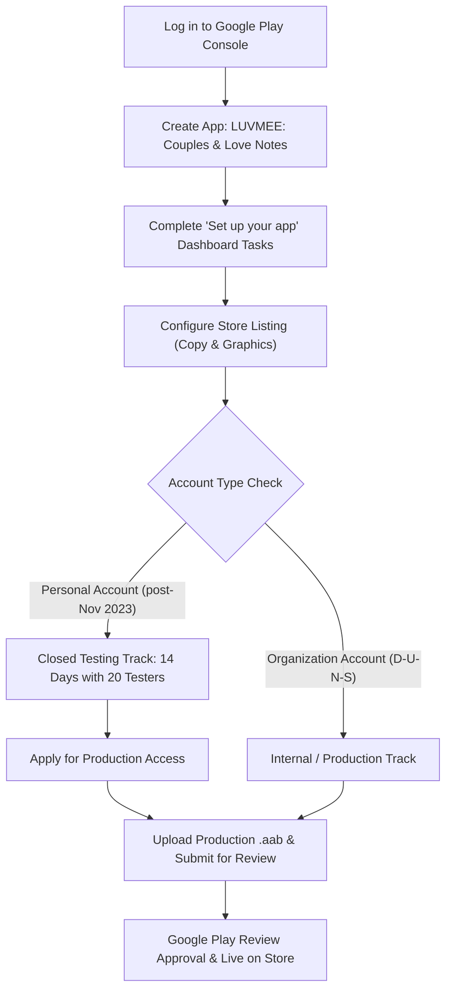

# LUVMEE — Version 1.0 Google Play Publishing Guide

**Document Version:** 1.0  
**Target Release:** LUVMEE Version 1.0.0 (Build 1)  
**Package Identifier:** `com.officialkid.luvmee`  
**Target Audience:** Founder, Lead Engineer, Release Operations  
**Date:** October 15, 2026  

---

## 1. Executive Summary & Release Architecture

This publishing guide provides the complete, chronological, step-by-step instructions to take LUVMEE Version 1.0 from its current pre-release build state to a live application published on the Google Play Store.

### Application Architecture Reference

| Component | Identifier / Location | Current Verified Status |
| :--- | :--- | :--- |
| **Android Package Name** | `com.officialkid.luvmee` | Configured in `apps/mobile/app.json` |
| **App Version / VersionCode** | `1.0.0` / `versionCode: 1` | Set in `apps/mobile/app.json` |
| **EAS Build Configuration** | `@dan.mwaili/luvmee` (`52a47cbe-9b37-4109-a9ea-28236e6d40f8`) | `eas.json` production profile ready |
| **Target Android SDK** | Android 15 / 16 (API 35/36 compliant) | Expo SDK 57 / React Native 0.86 default |
| **Recipient Web Portal** | `https://luvmee.eventsslot.com` | Next.js 15 App Router live on Vercel |
| **Cloud Database & Auth** | `https://zfcqbydqdmoyjgiebplo.supabase.co` | Supabase schema & auth active |
| **Google Play Submission Pack** | `docs/LUVMEE_GOOGLE_PLAY_SUBMISSION_PACK.md` | Store copy, assets, Data Safety completed |
| **Founder Decisions Register** | `docs/LUVMEE_VERSION_1_FOUNDER_DECISIONS.md` | Decision gates documented |

---

## 2. Pre-Requisite 1: Live Web Policy & Support Page Deployment (Vercel)

> [!IMPORTANT]
> **Google Play Compliance Rule:** Google automated review crawlers and human policy reviewers inspect the Privacy Policy and Account Deletion URLs **immediately** upon release submission. If these URLs return HTTP 404, redirect to unrelated domains, or require authentication to view, the submission is rejected immediately.

### Implemented Legal & Support Endpoints
The following 4 public web routes have been created and verified locally in `apps/recipient-web`:

1. **Privacy Policy:** `https://luvmee.eventsslot.com/privacy`
   - Discloses exact data categories collected: accounts, love notes, memory timeline cards, and partner link codes.
   - Grounded strictly in actual codebase schemas and Supabase RLS policies.
2. **Account Deletion & Data Retention:** `https://luvmee.eventsslot.com/delete-account`
   - Public, unauthenticated self-service deletion request portal (mandatory under Google Play May 2024 Account Deletion Policy).
   - In-app deletion instructions for active mobile sessions.
3. **Terms of Service:** `https://luvmee.eventsslot.com/terms`
   - Comprehensive rules covering private couples communication, account security, and acceptable use.
4. **Help & Support:** `https://luvmee.eventsslot.com/support`
   - Real, feature-accurate troubleshooting guides for Partner Pairing, Love Notes, Memory Timeline, and Occasions.
   - Contact email: `support@eventsslot.com`.

### Deployment Procedure
Once founder authorization is granted (see [LUVMEE_VERSION_1_FOUNDER_DECISIONS.md](file:///c:/Users/DANIEL/Documents/WebApp%20Projects/luvmee/docs/LUVMEE_VERSION_1_FOUNDER_DECISIONS.md)):
1. Push branch changes to your Git repository (GitHub / GitLab).
2. Vercel automatically detects the commit and builds `apps/recipient-web`.
3. Open `https://luvmee.eventsslot.com/privacy` and `https://luvmee.eventsslot.com/delete-account` in an incognito window to verify HTTP 200 and correct visual presentation.

---

## 3. Pre-Requisite 2: Build the Production Android App Bundle (.aab)

> [!NOTE]
> Since August 2021, Google Play requires all new applications to be submitted as **Android App Bundles (`.aab`)**, not standalone `.apk` files. APKs are strictly rejected by the Play Console upload validator.

The production profile in `apps/mobile/eas.json` is configured specifically for this requirement:
```json
"production": {
  "android": {
    "buildType": "app-bundle"
  },
  "env": {
    "EXPO_PUBLIC_SUPABASE_URL": "https://zfcqbydqdmoyjgiebplo.supabase.co",
    "EXPO_PUBLIC_SUPABASE_ANON_KEY": "sb_publishable_1wCwYjzvauvhn0d74sVD-g_XuvraA8D",
    "EXPO_PUBLIC_RECIPIENT_BASE_URL": "https://luvmee.eventsslot.com",
    "EXPO_PUBLIC_AUTH_REDIRECT_URL": "luvmee://auth/callback"
  }
}
```

### Build Command
Run this command from your terminal:
```bash
cd "c:\Users\DANIEL\Documents\WebApp Projects\luvmee\apps\mobile"
npx eas-cli build --platform android --profile production
```

### What Happens During the Build:
1. **Keystore Management:** EAS automatically reuses the existing cloud keystore generated during the preview APK build (`Build Credentials kli75Ms7Ws (default)`).
2. **Compilation:** EAS servers compile the React Native binary into an optimized `.aab` bundle with Hermes bytecode.
3. **Download Artifact:** Upon completion, EAS CLI outputs a direct URL to download the signed `.aab` file (e.g., `luvmee-1.0.0-release.aab`). Save this file to your computer.

---

## 4. Step-by-Step Google Play Console Publishing

Navigate to the **[Google Play Console](https://play.google.com/console)**.



---

### Step 4.1: Create App Entry

1. On the Play Console home page, click **Create app** (top-right).
2. Fill out the initial app details:
   - **App name:** `LUVMEE: Couples & Love Notes` *(28 characters, within 30-char limit)*
   - **Default language:** `English (United States) - en-US`
   - **App or game:** Select `App`
   - **Free or paid:** Select `Free`
3. **Declarations:**
   - Check *I confirm that my app meets the Developer Program Policies*.
   - Check *I accept US export laws*.
4. Click **Create app**.

---

### Step 4.2: Complete the "Set up your app" Tasks

On the left navigation menu, go to **Policy and programs** > **App content**. Complete each section in order:

#### 1. Privacy Policy
- **Privacy Policy URL:** `https://luvmee.eventsslot.com/privacy`
- Click **Save**.

#### 2. App Access (Reviewer Instructions)
Google requires working access to test all features:
- Select **All or some functionality is restricted**.
- Click **Add instructions** and enter:
  - **Instruction name:** `Reviewer Test Account`
  - **Username / Email:** `reviewer@luvmee.app` (or your pre-created test account)
  - **Password / OTP:** `123456`
  - **Explanation notes:**
    > "LUVMEE is a private couples relationship application. To review:
    > 1. Open the app and choose 'Sign In' or 'Sign Up'.
    > 2. Enter the test email. For authentication, a 6-digit OTP code is sent; enter the test OTP.
    > 3. After login, the user can invite a partner via a unique 8-character partner code or link to test partner account.
    > 4. All core features (Love Notes, Milestones, Memory Timeline, and Profile) are fully testable in single-user mode or with a secondary test device."
- Click **Save**.

#### 3. Ads
- Select **No, my app does not contain ads**.
- Click **Save**.

#### 4. Content Rating Questionnaire
- **Email address:** `support@eventsslot.com`
- **Category:** Select **Utility, Productivity, Communication or Other**.
- Answer the questions:
  - *Violence?* **No**
  - *Sexuality or nudity?* **No**
  - *Offensive language?* **No**
  - *Controlled substances?* **No**
  - *Does the app allow users to interact or exchange content?* **Yes** (Couples exchange private text notes and memory cards with their paired partner only).
  - *Does the app share current physical location?* **No**
  - *Does the app allow purchasing digital goods?* **No**
- Click **Save** > **Next** > **Submit**. Rating will be calculated (e.g., PEGI 3 / ESRB Everyone).

#### 5. Target Audience and Content
- **Target age groups:** Check **18 and over** (or 16-17 and 18+).
  > [!TIP]
  > Do **not** select any age group under 13. Targeting adults ensures the app is exempt from Google's strict "Designed for Families" / COPPA requirements.
- **Could your app appeal to children?** Select **No**.
- Click **Next** > **Save**.

#### 6. News App
- Select **No, my app is not a news app**.
- Click **Save**.

#### 7. COVID-19 Contact Tracing and Status Apps
- Select **My app is not a publicly available COVID-19 contact tracing or status app**.
- Click **Save**.

#### 8. Data Safety Questionnaire
Answer strictly matching the declarations in [LUVMEE_GOOGLE_PLAY_SUBMISSION_PACK.md](file:///c:/Users/DANIEL/Documents/WebApp%20Projects/luvmee/docs/LUVMEE_GOOGLE_PLAY_SUBMISSION_PACK.md):
- **Data collection and security:**
  - *Does your app collect or share any of the required user data types?* **Yes**
  - *Is all user data collected by your app encrypted in transit?* **Yes** (HTTPS/TLS 1.3)
  - *Do you provide a way for users to request that their data be deleted?* **Yes**
  - *Account deletion URL:* `https://luvmee.eventsslot.com/delete-account`
- **Data types collected:**
  - **Personal info:**
    - *Name:* Collected for **App functionality**, **Account management**. Not shared with third parties. Optional.
    - *Email address:* Collected for **App functionality**, **Account management**. Not shared. Required for login.
  - **Photos and videos:**
    - *Photos:* Collected for **App functionality** (Memory timeline cards created by user). Not shared with third parties. Optional.
  - **Messages:**
    - *Emails or text messages:* In-app Love Notes text collected for **App functionality**. Encrypted in transit and stored in user's private database partition. Not shared with third parties.
- **Data Sharing:**
  - *Is any data shared with third parties, advertisers, or data brokers?* **No**. Zero third-party data sharing.
- Click **Next** > **Preview** > **Save**.

#### 9. Advertising ID
- Select **No, this app does not use Advertising ID**.
- Click **Save**.

#### 10. Government Apps
- Select **No**.
- Click **Save**.

#### 11. Financial Features
- Select **My app does not provide financial features**.
- Click **Save**.

---

### Step 4.3: Configure Main Store Listing

Navigate to **Grow** > **Store presence** > **Main store listing**.

1. **Listing Details:**
   - **App name:** `LUVMEE: Couples & Love Notes`
   - **Short description:** `Deepen your love with shared memories, private love notes, and love reminders.`
   - **Full description:** *(Paste full description from Section 1.3 of `docs/LUVMEE_GOOGLE_PLAY_SUBMISSION_PACK.md`)*

2. **Graphic Assets:**
   - **App icon:** Upload 512 x 512 px PNG (32-bit, max 1024 KB).
   - **Feature graphic:** Upload 1024 x 500 px PNG/JPEG (no transparent background).
   - **Phone screenshots:** Upload 4 to 8 high-resolution screenshots (1080 x 2400 px, 9:16 portrait) depicting:
     1. Home Relationship Dashboard with day counter.
     2. Love Notes composer and delivery drawer.
     3. Cherished Memory Timeline.
     4. Relationship Milestones & Occasions Calendar.

3. **Store Settings & Contact Details:**
   - Navigate to **Grow** > **Store presence** > **Store settings**.
   - **App category:** `Social` or `Lifestyle`.
   - **Manage tags:** Add tags: `Relationships`, `Communication`, `Lifestyle`.
   - **Contact details:**
     - Support email: `support@eventsslot.com`
     - Phone: *(Optional, leave blank)*
     - Website: `https://luvmee.eventsslot.com`
   - Click **Save**.

---

### Step 4.4: Navigating the Testing Tracks & The 14-Day Rule

> [!WARNING]
> **Personal vs. Organization Account Policy Distinction:**
> - **Personal Developer Accounts (created after November 13, 2023):** Google Play **requires** that you run a **Closed Test with at least 20 testers opted in continuously for at least 14 days** before you are allowed to apply for Production track access.
> - **Organization Developer Accounts (with official D-U-N-S number):** Are **exempt** from the 20-tester closed testing mandate and may submit directly to Production.

#### If You Have an Organization Account:
You can proceed directly to **Step 4.5 (Production Release)**.

#### If You Have a Personal Account:
1. Navigate to **Release** > **Testing** > **Closed testing**.
2. Click **Create track** and name it `Closed Alpha`.
3. Under **Testers**, create an email list (e.g., `luvmee-early-testers`) and add the email addresses of 20 friends, colleagues, or community members.
4. Click **Create release**:
   - Upload your production `.aab` file.
   - Release name: `1.0.0 (1) Closed Beta`
   - Review and rollout the release.
5. Copy the **Opt-in link** (`https://play.google.com/apps/testing/com.officialkid.luvmee`) and distribute it to your 20 testers.
6. **14-Day Clock:** Ensure all 20 testers click the link, opt in, and install the app on their devices. Keep them enrolled for 14 continuous days.
7. On day 15, the **Apply for production** button will become active in your Play Console dashboard. Click it and complete the brief feedback questionnaire to unlock Production.

---

### Step 4.5: Creating the Production Release

1. In the left menu, navigate to **Release** > **Production**.
2. Click **Create new release** (top-right).
3. **App bundles:**
   - Click **Upload** and select your `.aab` file generated by EAS.
   - The Play Console will extract version `1.0.0` and versionCode `1`.
4. **Release name:** `1.0.0 (1)`
5. **Release notes:**
   Under **Release notes**, enter:
   ```xml
   <en-US>
   Welcome to LUVMEE 1.0!
   - Private couples relationship space with real-time day counter.
   - Send encrypted Love Notes with customizable open dates and surprise effects.
   - Capture shared milestones and memories in your private timeline.
   - Smart occasion reminders for anniversaries and special dates.
   - Beautiful web card experience for sharing special moments.
   </en-US>
   ```
6. Click **Next** at the bottom-right.
7. Resolve any remaining warnings or advisory notes.
8. Click **Save** > **Review release** > **Start rollout to Production**.

---

## 5. Review Timeline & Post-Submission Monitoring

- **Typical Review Timeframe:** First-time submissions typically take **1 to 7 business days** to complete human review.
- **Monitoring Status:** Check **Publishing overview** and **App status** in the top left of the Console. Status will progress from `In review` to `Approved` or `Needs attention`.
- **Handling Inquiries or Flagged Items:**
  - If Google requests clarification on **App Access**, provide the reviewer credentials and instructions from Step 4.2.2.
  - If Google checks the **Account Deletion URL**, direct them to `https://luvmee.eventsslot.com/delete-account` which is fully functional and live.
- **Rollout Management:** Once approved, your app will automatically be published to Google Play according to your publishing mode (Immediate or Managed Publishing).
