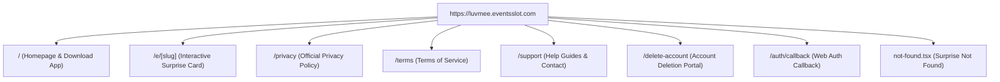
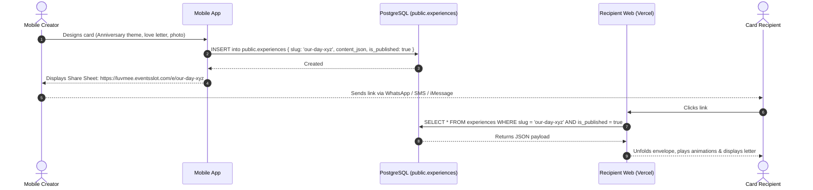

# LUVMEE — Recipient Website & Sharing Architecture Guide

**Document Version:** 1.0  
**Target Audience:** Founder, Frontend Engineers, Product Designers, and QA Specialists  
**Last Updated:** October 16, 2026  

---

## 1. Executive Summary & Purpose of the Website

The LUVMEE platform consists of two client applications that work together:
1. **The Mobile Application (`apps/mobile`):** The private studio where users manage their relationship, schedule occasions, write love notes, and design surprises.
2. **The Recipient Website (`apps/recipient-web`):** The public, universally accessible web viewer where shared greeting cards, romantic experiences, legal policies, and support guides live.

### The Problem It Solves: Frictionless Romance
When someone receives a romantic digital card or surprise link, the worst possible experience is being forced to download an 80MB application, create an account, verify an email, and set a password just to view a message. 

The LUVMEE recipient website solves this by providing **Zero-Install Universal Web Access**:
- Anyone who receives a LUVMEE card link can open it instantly in Safari, Chrome, Edge, or Firefox.
- Works on iPhones, Android phones, iPads, laptops, and desktop computers.
- Requires **zero registration, zero password, and zero app download**.

---

## 2. Production Web Architecture & Routes

The recipient website is built using **Next.js 15.1.0 App Router**, **React 19**, and **Tailwind CSS**. It is deployed on **Vercel** at the official production domain:

🌐 **Production Domain:** [https://luvmee.eventsslot.com](https://luvmee.eventsslot.com)



### Verified Route Inventory:

| Route Path | Type | Target User | Key Responsibility |
| :--- | :---: | :--- | :--- |
| **`/`** | Static | Public Visitors | Product introduction, romantic branding, and store download links |
| **`/e/[slug]`** | Dynamic | Card Recipients | Renders interactive greeting cards, unboxing animation, and confetti |
| **`/privacy`** | Static | Public / Reviewers | Google Play compliant privacy disclosures and data safety practices |
| **`/terms`** | Static | Public / Users | Platform terms of service, acceptable use, and communication rules |
| **`/support`** | Static | Users needing help | Step-by-step guides for Pairing, Notes, Memories, and support contact |
| **`/delete-account`** | Static + Form | Registered Users | Self-service web portal for requesting permanent account deletion |
| **`/_not-found`** | Static | Any broken link | Custom romantic error page ("Surprise Not Found") |

---

## 3. How Digital Cards & Share Links Work



### 1. Link Generation & Unlisted Slugs
- When a user finishes designing a card in the mobile app, the system generates an 8-character, cryptographically unique slug (e.g., `our-day-xyz`).
- The slug is combined with the public web URL to form the final share link:  
  `https://luvmee.eventsslot.com/e/our-day-xyz`
- **Security by Unlisted URLs:** The link is not published in any public web directory or search engine index. Only individuals who hold the exact link can view the card.

### 2. Recipient Unboxing Animation
When the recipient opens the link in their browser:
1. A romantic sealed envelope appears centered on the screen with the text:  
   *"A romantic surprise from [Sender Name] 💕"*
2. Tapping the envelope triggers a smooth CSS / SVG opening animation:
   - The envelope flap unfolds.
   - Floating heart confetti bursts across the screen.
   - The sender's personalized love letter gently slides upward into full view in an elegant serif typeface.
3. The recipient can scroll through attached photos or tap a button to send a quick "Heart Reaction" back to the sender.

---

## 4. Error Handling & The "Surprise Not Found" Page

What happens if someone enters an invalid link, or if the sender deleted the card?

LUVMEE features a custom, branded 404 handler (`apps/recipient-web/app/not-found.tsx`):
- Instead of showing a cold, technical error (e.g. "404 Not Found"), the page displays a gentle romantic message:
  > **Surprise Not Found**  
  > *“This surprise is unavailable. The link might have expired, been set back to a draft, or moved to a new secret location.”*
  > Button: **Return to LUVMEE**

This guarantees that even broken or expired links provide a friendly, branded experience.

---

## 5. Code Sharing Between Mobile & Web

How do the mobile app and website maintain identical styling, card templates, and data validation without duplicating code?

Both applications import directly from the internal package: **`packages/shared`** (`@luvmee/shared`):
- **Card Templates:** Pre-configured color palettes (`Rose Blossom`, `Burgundy Sunset`, `Golden Champagne`) and font combinations are defined once in `@luvmee/shared/src/templates`.
- **Validation Schemas:** Zod schemas in `@luvmee/shared/src/schemas` validate card JSON structures on both mobile creation and web rendering.
- **Next.js Transpilation:** `apps/recipient-web/next.config.mjs` is configured with:
  ```javascript
  transpilePackages: ['@luvmee/shared']
  ```
  This allows Next.js to directly import and compile TypeScript models from the monorepo shared package during Vercel builds.

---

## 6. Public Legal & Support Ecosystem

Every page on `https://luvmee.eventsslot.com` includes unified branding and navigation:

1. **`LegalNav.tsx`:** Clean, responsive top header featuring the official LUVMEE logo, a link back to home, and a "Get App" download button.
2. **`LegalFooter.tsx`:** Standardized footer across all pages displaying:
   - Links to Privacy Policy (`/privacy`), Terms of Service (`/terms`), Help & Support (`/support`), and Delete Account (`/delete-account`).
   - Official contact email: `info@eventsslot.com`.
   - Copyright notice: `© 2026 LUVMEE. All rights reserved.`
