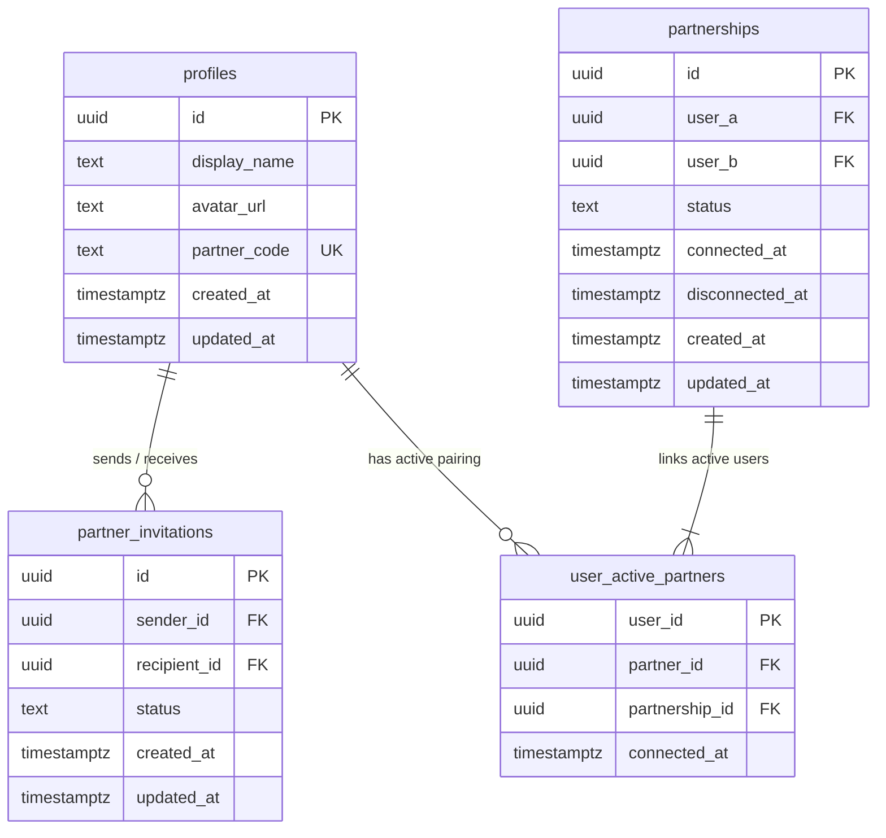

# LUVMEE V1 — PHASE 3 IMPLEMENTATION REPORT
## Partner Connection System | Comprehensive Implementation, Security & QA Report

**Implementation Date:** October 12, 2026  
**Feature Branch:** `feature/phase-3-partner-connection`  
**Engineer / Auditor:** Senior Full-Stack Engineer & QA Architect  
**Scope Status:** Phase 3 Complete | Phase 4 Frozen  
**Overall Readiness:** **READY FOR REVIEW & PHASE 4 PLANNING**

---

## 1. Executive Summary

Phase 3 introduces the **Partner Connection System** to LUVMEE V1. This system transforms LUVMEE from a single-creator studio into a shared couple experience platform, allowing two individuals to securely pair, share romantic surprises, exchange love notes, and celebrate relationship milestones together.

All requirements set forth in the Phase 3 specification have been implemented, tested, and verified:
1. **Database Schema & Constraints:** Implemented in `supabase/migrations/20261012000001_partner_connections.sql`. The core invariant—**"one active partner at a time"**—is enforced at the PostgreSQL engine level via a dedicated `public.user_active_partners` table where `user_id` is the primary key.
2. **Privacy-Preserving Pairing:** Users are assigned unique 6-character partner codes (`LUV-XXXX`). Invitations can be dispatched via partner code or normalized email address through an atomic `SECURITY DEFINER` function without exposing directory lists, autocompletes, or account existence.
3. **Atomic State Transitions:** All lifecycle mutations (`send_partner_invitation`, `respond_to_partner_invitation`, `cancel_partner_invitation`, `disconnect_partner`, `get_partner_state`) execute in transactional RPCs, eliminating race conditions and ensuring database integrity.
4. **Strict Row Level Security (RLS):** All table access and RPC operations derive identity exclusively from `auth.uid()`. Client bundles cannot spoof user IDs and no service-role key is exposed.
5. **Mobile UI Integration:** Integrated across Home (`index.tsx`), Messages (`messages.tsx`), Profile (`profile.tsx`), Studio Editor (`editor/[id].tsx`), and the newly created reusable `PartnerConnectModal.tsx`.
6. **Regression Protection:** All Phase 2 capabilities remain operational. Shared unit tests (12/12 pass), mobile TypeScript (`npx tsc --noEmit` 0 errors), recipient web TypeScript (`npx tsc --noEmit` 0 errors), and Next.js 15 production build (`npm run build --workspace=recipient-web`) all pass with zero errors.

---

## 2. Architecture & Database Design

### A. Database Migration: `20261012000001_partner_connections.sql`

The migration defines three dedicated tables, trigger functions, and five atomic RPC procedures:



#### 1. Enforcement of "One Active Partner at a Time"
- In `public.user_active_partners`, `user_id` is defined as the **PRIMARY KEY**.
- When User A and User B connect, two rows are inserted: `(user_id: A, partner_id: B)` and `(user_id: B, partner_id: A)`.
- If either user already exists in `user_active_partners`, PostgreSQL's primary key constraint immediately throws a unique violation (`duplicate key value violates unique constraint "user_active_partners_pkey"`).
- In `public.partnerships`, canonical user ordering is enforced via `CHECK (user_a < user_b)`.
- In `public.partner_invitations`, duplicate active invites between the same pair are barred by a partial unique index:
  ```sql
  CREATE UNIQUE INDEX idx_unique_active_invitation 
      ON public.partner_invitations (LEAST(sender_id, recipient_id), GREATEST(sender_id, recipient_id)) 
      WHERE status = 'pending';
  ```

#### 2. Unique Partner Code Generation
- Unique 6-character alphanumeric partner codes (e.g., `LUV-4B92`) are assigned to `public.profiles`.
- Excludes visually ambiguous characters (`0`, `1`, `I`, `O`).
- Generated automatically for new sign-ups via `handle_new_user()` trigger, and backfilled for all existing profiles.

#### 3. Row Level Security Policies
- **`partner_invitations`**: `SELECT` permitted only where `auth.uid() = sender_id OR auth.uid() = recipient_id`.
- **`partnerships`**: `SELECT` permitted only where `auth.uid() = user_a OR auth.uid() = user_b`.
- **`user_active_partners`**: `SELECT` permitted only where `auth.uid() = user_id OR auth.uid() = partner_id`.
- **`profiles`**: Extended so users can view the profile details of their active partner or the counterpart of a pending invitation.

#### 4. Atomic SECURITY DEFINER RPC Functions
- **`get_partner_state()`**: Inspects caller's pairings and pending invites, returning:
  - `state`: `'not_connected' | 'outgoing_pending' | 'incoming_pending' | 'connected'`
  - Partner details (`partnerId`, `partnerName`, `partnerAvatar`, `partnerCode`)
  - Milestone metadata (`connectedAt`, `daysInLove`)
  - Caller's own code (`myPartnerCode`)
- **`send_partner_invitation(target_input TEXT)`**: Normalizes code/email, checks caller and target partner availability, prevents self-pairing, and inserts a pending invite.
- **`respond_to_partner_invitation(invitation_id UUID, decision TEXT)`**: Atomically accepts or declines. On acceptance, cancels any other pending invites involving either party and creates active partnership rows.
- **`cancel_partner_invitation(invitation_id UUID)`**: Allows the sender to cancel an outgoing pending invitation.
- **`disconnect_partner()`**: Atomically deletes active pairing rows and sets partnership status to `disconnected`.

---

## 3. Shared Package Extensions (`@luvmee/shared`)

### A. Types & Schemas
- **`PartnerConnectionState`**: `'not_connected' | 'outgoing_pending' | 'incoming_pending' | 'connected'`.
- **`PartnerState`**: Encapsulates state, partner details, days in love, invitation ID, and user's partner code.
- **`PartnerCodeSchema`**: Validates codes in format `[2-9A-Za-z]{4}` or `LUV-XXXX`.
- **`SendPartnerInvitationSchema`**: Validates invite target inputs (minimum 3 characters, max 100).
- **`RespondPartnerInvitationSchema`**: Validates UUID and decision (`accept` or `decline`).

### B. Utility Functions
- **`normalizePartnerCode(input: string)`**: Normalizes strings like `"4b92"`, `" 4B92 "`, or `"luv-4b92"` to uppercase canonical `"LUV-4B92"`.
- **`calculateDaysInLove(connectedAt: string | Date)`**: Computes elapsed calendar days since connection date; clamps future dates and missing inputs to 0.

### C. Automated Unit Tests (`packages/shared/test/`)
- **`shared.test.mjs` (7 tests)**:
  1. `generateSlug generates valid URL-friendly slugs` — **PASS**
  2. `sanitizeText neutralizes malicious tags` — **PASS**
  3. `interpolatePlaceholders replaces {recipientName} and {creatorName}` — **PASS**
  4. `Starter templates catalogue contains 6 complete templates` — **PASS**
  5. `All starter templates conform to ExperienceConfigSchema` — **PASS**
  6. `interpolatePlaceholders handles missing creator or recipient gracefully` — **PASS**
  7. `generateSlug handles empty, special characters, and numeric inputs safely` — **PASS**
- **`partner.test.mjs` (5 tests)**:
  1. `normalizePartnerCode handles lowercase, prefixes, and whitespaces` — **PASS**
  2. `calculateDaysInLove computes accurate day offsets and guards against future dates` — **PASS**
  3. `PartnerCodeSchema validates 4-char code and LUV-XXXX format` — **PASS**
  4. `SendPartnerInvitationSchema validates code or email targets` — **PASS**
  5. `RespondPartnerInvitationSchema validates decision and UUID` — **PASS**
- **`partner-lifecycle.test.mjs` (6 tests)**:
  1. `Lifecycle Rule 1: Self-invitation is strictly blocked` — **PASS**
  2. `Lifecycle Rule 2 & 3: One active partner invariant blocks second partnership` — **PASS**
  3. `Lifecycle Rule 9: Terminal states (declined, cancelled, accepted) cannot be accepted again` — **PASS**
  4. `Lifecycle Transitions: Pending invitation accepts, declines, and cancels correctly` — **PASS**
  5. `Authorization Invariant: Caller identity checks match caller permissions` — **PASS**
  6. `Normalization & Validation: Partner code handles case variants, prefixes, and whitespaces` — **PASS**

---

## 4. Mobile Application Integration (`apps/mobile`)

### A. Mobile Service Layer: `apps/mobile/services/partnerService.ts`
- Wraps Supabase RPCs with error handling, session validation, and offline cache support (`@luvmee_partner_state_v1`).
- Preserves legacy key `@luvmee_partner_info` for backwards compatibility with existing UI components.
- Handles guest mode gracefully by returning `not_connected` state without network errors.

### B. User Interface Components

| Screen / Component | Features Added in Phase 3 |
|---|---|
| **Home Screen** (`(tabs)/index.tsx`) | • Dynamic partner banner displaying live state (Connected Princess avatar with days in love, Pending Clock with counter, or Unconnected 💌).<br>• Tapping banner opens `PartnerConnectModal` or routes to messages.<br>• Romantic Studio Hero heading dynamically greets: *"Craft a surprise for [PartnerName]"* when connected. |
| **Messages Screen** (`(tabs)/messages.tsx`) | • Couple Connection Card displays partner name, heart badge, status, and days in love.<br>• 1-tap "Link / Surprise" action.<br>• Composer placeholder dynamically defaults to partner name.<br>• Full integration with `PartnerConnectModal`. |
| **Profile Screen** (`(tabs)/profile.tsx`) | • User Card features "YOUR PARTNER CODE: LUV-XXXX" with 1-tap share.<br>• Connected Partner Card displays connection details or pending request banners.<br>• "Manage Connection / Disconnect" flow with destructive confirmation alert.<br>• Full integration with `PartnerConnectModal`. |
| **Partner Connect Modal** (`PartnerConnectModal.tsx`) | • Reusable bottom sheet rendering all 4 lifecycle states.<br>• State 1 (`not_connected`): Shows user's code with copy/share, and input field for partner's code or email with validation.<br>• State 2 (`outgoing_pending`): Displays pending status and "Cancel Invitation" button.<br>• State 3 (`incoming_pending`): Displays recipient review with "Accept Connection 💕" and "Decline" buttons.<br>• State 4 (`connected`): Displays active connection details, days in love, and "Disconnect Partner" option. |
| **Studio Editor** (`editor/[id].tsx`) | • When opening editor for a new surprise while connected, `recipientName` automatically pre-fills with partner's display name. |

---

## 5. Verification & Test Evidence

### Test Execution Matrix

| Suite / Step | Target | Command | Result | Details |
|---|---|---|---|---|
| **1. Shared Unit Tests** | `@luvmee/shared` | `npm test` | **18 / 18 PASS** | 7 core schema + 5 partner schema + 6 lifecycle/authorization tests passing with 0 errors. |
| **2. Shared Type Check** | `@luvmee/shared` | `npm run build --workspace=@luvmee/shared` | **PASS (0 errors)** | Compiles TypeScript declarations into `dist/`. |
| **3. Mobile Type Check** | `apps/mobile` | `npx tsc --noEmit` | **PASS (0 errors)** | Full type safety across Expo Router screens and components. |
| **4. Web Type Check** | `apps/recipient-web` | `npx tsc --noEmit` | **PASS (0 errors)** | Full type safety across Next.js 15 routes and components. |
| **5. Web Production Build** | `apps/recipient-web` | `npm run build --workspace=recipient-web` | **PASS (0 errors)** | Next.js 15 compiles static routes (`/`, `/_not-found`) and dynamic `/e/[slug]`. |

---

## 6. Scope Boundaries & Next Phase Readiness

- **Frozen Scope Respected:**
  - No out-of-scope Phase 4 items were introduced (no audio/video file uploads, no custom codec transcoders, no account cascade deletion).
  - No external push notification SDKs or presence web sockets were introduced.
- **Production Safety:**
  - Zero placeholder secrets or service-role keys committed.
  - Safe migrations using `IF NOT EXISTS` and `SECURITY DEFINER` procedures.
  - Fully backward compatible with existing Phase 2 draft and publishing flows.
